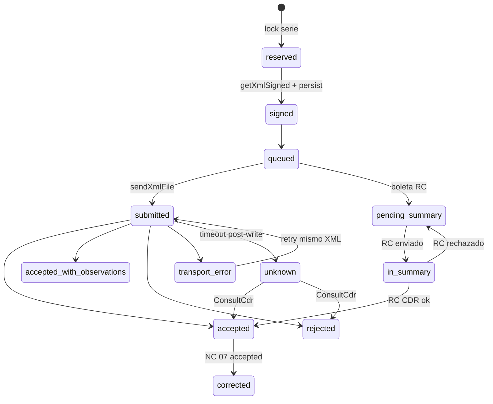

# necofact.pe — plan técnico inicial

**Fecha:** 2026-08-23  
**Producto:** sistema de ventas para clientes. Artefacto primario: CPE (`01`, `03`, `07`) y GRE remitente (`09`).  
**No es:** plugin SUNAT para Faztore/Aeduca, ERP, CRM, ni un POS que “imprime factura”.

Este archivo cierra arquitectura y el primer corte implementable. No es spec de pantallas ni diseño del binario PDF.

---

## Evidencia inspeccionada

| Fuente | SHA / versión | Qué se usó |
|---|---|---|
| `eliaschampi/faztore` | `0c8790cd` | `docs/Architecture.md`, `database/init/01-tables.sql`, `inventory.repository.ts`, `cashbox.repository.ts` |
| `eliaschampi/coedula` | `162ad7e8` | `docs/ARCHITECTURE.md`, `docs/PRODUCT.md` (caja R-01, omr-rs, no-ceremonia) |
| `eliaschampi/aeduca` | `131efcfd` | `AGENTS.md`, `docs/SPEC.md` §6 caja/pagos, `composer.json` Laravel `^13.8` PHP `^8.5` |
| `eliaschampi/omr-rs` | `ecbcc6d8` | protocolo stdin/stdout; patrón del binario PDF |
| `thegreenter/greenter` | `c9faa408` / **v5.3.0** (2026-06-08) | `See.php`, `CdrResponse.php`, `GreSender.php` |
| SUNAT | guías CPE, mod. 24-jul-2026; reglas 30-jul-2026 | UBL 2.1, RC, plazos |

---

## 0. Decisiones ya cerradas

| Decisión | Valor |
|---|---|
| Producto | **necofact.pe**, proyecto **nuevo**, para clientes |
| No tocar | Faztore, Aeduca, Coedula. Cero SUNAT ahí |
| Forma | **Un solo app Laravel 13**. Ventas + fiscal juntos |
| SUNAT como segundo deployable / Lycet / microservicio | **No.** Greenter es librería |
| Package Composer interno `necofact/sunat` | **No en v1.** Extraer sólo si aparece un segundo consumidor PHP real |
| Stack | Laravel 13 · PHP 8.5 · Inertia · Svelte 5 runes · TypeScript strict · Lumi · PostgreSQL · pnpm · Greenter 5.3.x fijado en `composer.lock` |
| PDF | Binario externo, patrón `omr-rs` / `OmrEngine`. No diseñar el interior |
| Métrica CPE/GRE | Calidad del ciclo de vida, **no** latencia SOAP |
| Primer despliegue | 1 RUC / 1 deployment / N sedes. Schema con `issuer_code` |
| Multi-tenant SaaS compartido | Fuera de v1 |
| SIRE / FV 621 / percepción / retención / detracción / ND UI | Fuera del primer corte |
| Wrapper `laravel-greenter` | No |

### Por qué no separar “SUNAT layer”

La pregunta anterior partía de integrar SUNAT en Faztore o Aeduca. Esa premisa quedó descartada.

Separar un segundo proyecto PHP sólo para Greenter duplicaría lo que **tiene que ocurrir en la misma transacción que la venta**:

```
reserva de serie/correlativo
snapshot del receptor
INSERT fiscal_documents + items
outbox / afterCommit
```

Greenter ya es el aislamiento correcto: una librería detrás de un adapter. Lycet sería otro deploy, otra red y otro failure domain, sin ganancia mientras el único runtime sea Laravel.

La frontera no es de proceso. Es de **ownership de tipos**:

```
App\Actions\Sales\*          dueño de stock, caja, venta
App\Actions\Fiscal\*         dueño de CPE/GRE, correlativo, XML, CDR
App\Support\Sunat\*          único lugar que importa Greenter\*
App\Support\Pdf\*            único lugar que spawnea el binario
```

Greenter no aparece en controllers, models públicos, Inertia, ni JSON.

---

## 1. Tesis de producto

Los sistemas de venta tradicionales peruanos tratan la factura como un printout del movimiento de stock. Mezclan anulación de caja con baja SUNAT, reutilizan el correlativo interno como serie tributaria, y convierten al cliente en un CRM.

NecoFact invierte eso:

> La operación comercial existe para producir un documento electrónico correcto, recuperable y corregible. Stock, caja y clientes son el mínimo que hace eso usable todos los días.

Consecuencias:

1. `Sale` y `FiscalDocument` son agregados distintos. Una anulación de venta no borra un XML aceptado.
2. El cliente es **identidad tributaria**, no ficha comercial.
3. La caja es ledger de **efectivo físico**. Yape/transferencia/tarjeta no entran a caja.
4. GRE no es una transferencia de Faztore con otro nombre. Es un documento SUNAT con ticket y CDR propios.
5. El POS elige `01` o `03` **antes** de confirmar. No hay “venta ahora, factura después” en el flujo normal. El vínculo `sale 1 — 0..n fiscal_documents` existe para notas, reintentos y GRE, no para diferir la obligación.

Faztore, Coedula y Aeduca aportan **disciplina de código**, no el producto.

---

## 2. Qué se hereda, qué se descarta

Prioridad de ingeniería (Faztore `docs/Architecture.md`; Coedula la reitera):

```
correctness → readability → consistency → performance → simplicity
```

En facturación, “performance” nunca justifica regenerar XML, reciclar correlativo o tratar un timeout como rechazo.

### Copiar

| Origen | Patrón | Uso en NecoFact |
|---|---|---|
| Faztore | Producto ≠ variante. Stock vive en la variante | SKU vendible = `product_variants` |
| Faztore | `inventory_balances` sparse `(variant_code, branch_code)` | No materializar filas en cero. `INSERT … ON CONFLICT DO NOTHING` antes del update |
| Faztore | `applyInventoryDelta`: `UPDATE … SET on_hand = on_hand + Δ WHERE on_hand >= abs(Δ)` si Δ < 0 | 0 filas → error de dominio, no saldo negativo. El `CHECK (on_hand >= 0)` es red de seguridad |
| Faztore | Compra `in_transit \| received \| cancelled`. `FOR UPDATE` en receive/cancel | Recibir muta stock y costo promedio; cancel received resta stock |
| Faztore | Venta `posted \| voided`. Void restaura stock y revierte caja | Estado **comercial**, no fiscal |
| Faztore | Transferencia inmediata 1 variante, origen ≠ destino | Stock entre sedes. **Inmutable** una vez ligada a GRE |
| Faztore | Caja **user-scoped**, sin sesión abrir/cerrar | `cashier_user_code` + `business_date` |
| Faztore | `pg_advisory_xact_lock(hashtext(ns), hashtext(cashier))` antes de salida | Evitar saldo negativo bajo concurrencia |
| Faztore | Rutas delgadas; SQL e invariantes fuera del controller | En Laravel: Actions / queries, no repositories ceremoniales |
| Faztore | UUID `code`, `America/Lima`, Lumi only, `pnpm run check` | Igual |
| Coedula | Service **no es ceremonia**. Sólo si orquesta o transacciona | Nada de `XService` que reenvía a un repo |
| Coedula R-01 | Caja física ≠ medio de pago externo. Día operativo = hoy Lima | Sólo `cash` escribe `cashbox_movements` |
| Coedula | Idempotencia de red (`request_key` + fingerprint) | `Idempotency-Key` en el POST de venta |
| Coedula / Aeduca | Binario especializado fuera del request de página | `PdfEngine` |
| Aeduca | Actions dueñas del write de agregado | `RecordSale`, `IssueCpe`, … |
| Aeduca | FormRequest valida; controller compone Inertia | Igual |
| Aeduca | PostgreSQL `CHECK` / `FK` / `UNIQUE` como última barrera | Incluye correlativo fiscal |
| Aeduca | `VoidPayment` ≠ efecto tributario | `VoidSale` ≠ Nota de Crédito / RC / RA |
| Aeduca | Cola ya en el runtime (`queue:listen`) | SOAP/REST SUNAT **después del commit** |
| Aeduca | `user_branches` explícito, no `UUID[]` | Faztore `branches.users UUID[]` **no** se copia |

### No copiar

| Origen | Qué | Por qué |
|---|---|---|
| Faztore `customers` | `full_name, phone, notes` | SUNAT necesita tipo/número de doc, razón social, domicilio. Sin eso no hay factura |
| Faztore `sales.payment_method` | Un solo medio, total entero a caja si hay `cashboxPayment` | Una venta puede mezclar efectivo + Yape; sólo el efectivo es caja |
| Faztore `voidSale` | Restaura stock + revierte caja y listo | Si hay CPE `accepted`, hay que emitir `07` o informar baja |
| Faztore `updateProductTransfer` / `deleteProductTransfer` | Reescribir stock de una transferencia ya posted | Una GRE aceptada no se “edita”. Compensación = otro documento |
| Faztore money | `Number()` + `Math.round(x*100)/100` | Totales fiscales: `NUMERIC` en backend |
| Faztore `products.discount_amount INTEGER` | campo huérfano | No existe en NecoFact |
| Aeduca `payments` | Recibo con conceptos académicos, alumno, mensualidad | NecoFact vende SKUs, no pensiones |
| Aeduca `Money` cents como único tipo | `int` cents | UBL usa más de 2 decimales en valor unitario. Cents para **totales de caja**; `NUMERIC` para líneas fiscales |
| Greenter docs (`greenter.dev/starter`) | `$see->send($invoice)` como camino feliz | Regenera XML en cada llamada. Contrato nuestro: persistir XML firmado y reenviar con `sendXml` / `sendXmlFile` |
| Greenter `HtmlReport` / `htmltopdf` | PDF in-process | El PDF es un binario externo |
| Informe anterior | API `/api/v1` para que Faztore sea el primer consumidor | Este producto **es** el sistema de ventas del cliente. Integraciones externas no son v1 |

---

## 3. Stack y layout

Runtime idéntico a Aeduca v8 (`laravel/framework ^13.8`, `php ^8.5`, Inertia 3, Svelte 5, Lumi, PostgreSQL, pnpm). Frontend igual de moderno que Faztore (Svelte 5.56, TypeScript 5.9, Vite 8, Lumi) **sin** un segundo servidor Node.

```
necofact/
├── app/
│   ├── Actions/
│   │   ├── Sales/          RecordSale, VoidSale
│   │   ├── Purchases/      RecordPurchase, ReceivePurchase, CancelPurchase
│   │   ├── Inventory/      TransferVariant
│   │   ├── Cashbox/        RecordManualIncome, RecordOutflow, TransferCash, ReturnOutflow
│   │   ├── Customers/      UpsertCustomer
│   │   └── Fiscal/         IssueCpe, IssueCreditNote, QueueDailySummary,
│   │                       VoidBySummary, IssueDespatch, ReconcileSunatStatus
│   ├── Http/
│   │   ├── Controllers/    Inertia, delgados
│   │   └── Requests/       FormRequests
│   ├── Jobs/
│   │   ├── SendCpeJob
│   │   ├── SendSummaryJob
│   │   ├── PollTicketJob
│   │   ├── ReconcileCpeJob
│   │   └── RenderPdfJob
│   ├── Models/             Eloquent mínimo; invariantes en SQL + Actions
│   └── Support/
│       ├── Money.php                 caja / totales de 2 decimales
│       ├── Fiscal/
│       │   ├── TaxMath.php           bases, IGV, redondeo UBL
│       │   ├── Correlative.php       lock + UNIQUE
│       │   └── CpeState.php          transiciones
│       ├── Sunat/
│       │   ├── CpeGateway.php        interfaz
│       │   ├── GreGateway.php        interfaz
│       │   ├── GreenterCpeGateway.php
│       │   ├── GreenterGreGateway.php
│       │   ├── SunatEndpoints.php    config, no class de Greenter
│       │   └── ArtifactStore.php     XML / CDR / hashes
│       └── Pdf/
│           └── PdfEngine.php         spawn binario
├── database/migrations/
├── resources/js/Pages/     Svelte 5 + Lumi
└── tests/
    ├── Feature/
    └── Fiscal/             fixtures XML, fakes de gateway
```

Dependencias Composer fiscales:

```
thegreenter/greenter          # meta: lite + xml + ws + core  @ 5.3.x
ext-soap, ext-zlib, ext-openssl, ext-curl
```

Spike del día uno: `composer require` en rama aislada y `composer run check`. PHP 8.5 es reciente; Greenter declara `>=7.4`, no un techo. Si una transitiva falla, se documenta y se pinnea. No se reescribe UBL.

No `greenter/report`. No `greenter/htmltopdf`. No `codersfree/laravel-greenter`.

Cola inicial: `database`. Redis sólo cuando una métrica lo pida.

Timezone: `America/Lima` en app, DB y Greenter (`TimeZonePe`). Fecha de emisión = fecha civil Lima, no UTC recortado.

---

## 4. Agregados y relaciones

```
Issuer 1 ── N Branch
Issuer 1 ── N FiscalSeries          (tipo, serie, next_number)
Issuer 1 ── N Customer              (identidad mutable)
Issuer 1 ── N Product 1 ── N ProductVariant

Branch × Variant ── InventoryBalance     (sparse)

Sale
 ├── SaleItem[]                  (variant, qty, unit_price, unit_cost, tax_affectation)
 ├── SalePayment[]               (method, amount)     -- NecoFact, no Faztore
 ├── CashboxMovement[]           (sólo si hay efectivo)
 └── FiscalDocument[]            (0..n: 01/03 inicial, luego 07)

FiscalDocument
 ├── FiscalDocumentItem[]        (snapshot; no FK viva a variant para el XML)
 ├── SunatSubmission[]
 ├── FiscalArtifact[]            (signed_xml, cdr_zip, cdr_xml, pdf)
 └── FiscalRelation[]            (origen ↔ nota / baja / GRE)

Despatch (GRE)
 ├── DespatchItem[]
 ├── Shipment snapshot           (motivo, modalidad, fechas, origen/destino, vehículo, conductor)
 └── mismo submission/artifact   (ticket REST, no SOAP sendBill)

DailySummary / VoidedCommunication
 └── items que referencian boletas o documentos a dar de baja
```

Reglas:

- `sales.sale_number` (`VEN-000123`) **nunca** es `F001-123`.
- `receipt_number` de Aeduca no existe aquí.
- `Sale.status` ∈ `{posted, voided}`.
- `FiscalDocument.status` es otra máquina (§10).
- Una venta posted puede tener CPE `rejected` o `transport_error`. Eso no deshace el stock.
- Una venta **no** se voided si tiene CPE `accepted` sin documento de corrección aceptado. La UI ofrece “Nota de crédito” / “Informar baja”, no “Anular” silencioso.

```
RecordSale (1 transacción DB)
  INSERT sales, sale_items, sale_payments
  UPDATE inventory_balances
  INSERT cashbox_movements          -- sólo cash
  LOCK fiscal_series FOR UPDATE
  INSERT fiscal_documents + items   -- snapshot + correlativo
  INSERT outbox / dispatch afterCommit
COMMIT
  → SendCpeJob | (boleta → queda pending_summary)
  → RenderPdfJob
```

SUNAT no se llama dentro del `DB::transaction`. El lock de serie sí.

---

## 5. Clientes — módulo esencial SUNAT

No es un CRM. No hay pipeline, no hay historial de marketing, no hay “notas largas” como campo principal.

Faztore hoy **no sirve** como modelo. Su tabla real:

```sql
CREATE TABLE public.customers (
  code UUID NOT NULL DEFAULT gen_random_uuid(),
  full_name VARCHAR(180) NOT NULL,
  phone VARCHAR(40) NULL,
  notes TEXT NULL,
  ...
);
```

Sin tipo de documento, sin número, sin razón social, sin domicilio, sin ubigeo. Con eso se emite boleta informal; **no** se emite factura.

El modelo mutable `customers` existe sólo para no reescribir RUC/DNI en cada venta. El CPE **no lee** esa fila al reimprimir ni al reenviar: lee el snapshot en `fiscal_documents`.

### Campos de `customers`

| Columna | Catálogo / regla | Obligatorio |
|---|---|---|
| `code` UUID PK | | sí |
| `issuer_code` | | sí |
| `doc_type` | Catálogo 06 | sí |
| `doc_number` | DNI 8, RUC 11, CE/pasaporte según tipo | sí |
| `legal_name` | nombre o razón social | sí |
| `address_line` | `Client.address.direccion` | factura: sí; boleta: si se conoce |
| `ubigeo` | 6 dígitos | factura: sí |
| `department, province, district` | | recomendado; se puede derivar de ubigeo |
| `email` | entrega XML/PDF | no |
| `phone` | | no |
| `is_active` | | sí |

Constraints:

```sql
UNIQUE (issuer_code, doc_type, doc_number)
CHECK (doc_type IN ('0','1','4','6','7','A','B','C','D','E','F','G','H'))
CHECK (
  (doc_type = '1' AND doc_number ~ '^[0-9]{8}$')
  OR (doc_type = '6' AND doc_number ~ '^[0-9]{11}$')
  OR (doc_type = '0' AND doc_number = '00000000')
  OR (doc_type NOT IN ('0','1','6'))
)
```

Mapeo 1:1 a `Greenter\Model\Client\Client`:

```
doc_type      → setTipoDoc
doc_number    → setNumDoc
legal_name    → setRznSocial
address_*     → Greenter\Model\Company\Address
email         → setEmail
phone         → setTelephone
```

Address Greenter (campos reales; el typo `ubigueo` es de Greenter, no nuestro schema): `ubigueo`, `codigoPais='PE'`, `departamento`, `provincia`, `distrito`, `urbanizacion`, `direccion`, `codLocal`.

`codLocal` es del **emisor** (anexo SUNAT, default `'0000'`), no del cliente. Vive en `branches.sunat_establishment_code`.

### Consumidor final

Fila especial, una por emisor, no borrable:

```
doc_type    = '0'
doc_number  = '00000000'
legal_name  = 'CLIENTE VARIOS'
```

### Reglas de emisión (el Action las enforce, no la UI sola)

| CPE | Receptor |
|---|---|
| Factura `01` | `doc_type = '6'` y RUC 11 dígitos. Exportación: fuera de v1 |
| Boleta `03` total < 700 PEN | consumidor final o DNI/CE/pasaporte |
| Boleta `03` total ≥ 700 PEN | identidad real (típicamente DNI `1`) |

No hay `if (ruc.startsWith("10")) invoice = false`. La capacidad de emitir `01` la define el **régimen del emisor** (`issuers.tax_regime` / `capabilities`), no el prefijo del RUC del cliente. Un RUC 10 en RER/RMT/RG sí recibe factura; NRUS no emite `01` aunque el cliente tenga RUC 20.

### UX

- Búsqueda por número de doc (prefix) y por nombre. Exacto de doc rankea primero, igual que el directorio de Aeduca.
- Al elegir factura, el campo se restringe a RUC. v1 es captura manual validada; padrón SUNAT es después.
- Crear/editar cabe en un diálogo. No hay módulo “clientes” con 12 pestañas.
- Editar un cliente **no** reescribe CPE históricos.
- El POS puede crear el cliente en el mismo ticket (doc + nombre + dirección si factura) sin salir a otra página.

---

## 6. Productos, inventario, compras, ventas

Calco operacional de Faztore (`InventoryRepository`), recortado a lo que CPE/GRE necesitan. El código de Faztore es la referencia de invariantes, no se pega Kysely en Laravel.

### Productos

```
products            code, name, is_active
product_variants    code, product_code, sku, name,
                    unit_code,          -- Catálogo 03, default NIU
                    tax_affectation,    -- Catálogo 07, default '10'
                    sale_price NUMERIC(12,2),
                    cost_price NUMERIC(12,2),
                    is_active           -- Faztore no lo tiene; operabilidad vive en products.is_active. Copiar eso.
```

`tax_affectation` vive en la **variante**. El Action de venta la copia a la línea; el cajero puede cambiarla (exonerado `20`, inafecto `30`), pero el default sale del SKU. Nunca hardcodear 18 %.

No UNSPSC, no recetas, no lotes, no series de producto en v1.

`UNIQUE (sale_code, variant_code)` como Faztore: una variante no se repite en el mismo ticket (`assertDistinctVariantLines`).

### Inventario

Igual que Faztore:

- fila sparse; `INSERT … ON CONFLICT DO NOTHING` antes del update
- `UPDATE … SET on_hand = on_hand + Δ WHERE on_hand >= abs(Δ)` si Δ < 0
- 0 filas actualizadas → error de dominio
- lock `FOR UPDATE` de variantes al recibir compra (costo promedio concurrente)
- productos inactivos no se venden, compran ni transfieren
- costo promedio ponderado al recibir (misma fórmula Faztore, con `NUMERIC` no `number`)

`on_hand` entero en v1 (`assertPositiveInteger`). Granel = cambio explícito a `NUMERIC(12,3)` después.

No exponer “poner stock = N”. Si hace falta corrección, un `inventory_adjustments` con delta firmado, actor y motivo — no en v1 salvo que un piloto lo exija. Faztore ya lo documentó como Phase 3; NecoFact no adelanta eso.

### Compras

Estados Faztore: `in_transit | received | cancelled`, con el CHECK de timestamps (`received_at` / `cancelled_at`) copiado.

- Default **siempre** `in_transit`. Recibo inmediato es elección explícita (Faztore inventory-flow review).
- `in_transit`: no toca `on_hand`.
- `received`: entra stock + actualiza `cost_price`. Persistir `received_by_user_code` (Faztore todavía no lo hace; NecoFact sí).
- `cancelled` desde `received`: sale stock; desde `in_transit`: no hay movimiento.
- Pago de compra en efectivo: `cashbox_movements` `direction=out` con lock de caja.
- Pago Yape/transferencia al proveedor: **no** mueve caja física.

La compra **no** emite CPE de venta. RCE / factura de compra no es v1. GRE de entrada (transportista) no es v1.

### Ventas

`RecordSale` es el vertical que demuestra el producto.

Entrada del POS:

```
branch, cashier,
customer (o consumidor final),
document_type: 01 | 03,
series (default de la sede),
payments[],          -- al menos uno; sum = total
items[]              -- variant, qty, unit_price (tax-inclusive), tax_affectation
note?
Idempotency-Key
```

El backend:

1. Recalcula bases, IGV y total. **Ignora** el total del frontend.
2. Precios se capturan **con IGV incluido** (modo retail). `TaxMath` deriva valor unitario y precio unitario UBL.
3. Stock − qty.
4. Pagos: split. `cash` → movimiento de caja `in`. El resto sólo queda en `sale_payments`.
5. Reserva correlativo + snapshot fiscal.
6. Commit + job.

`VoidSale` (comercial):

```
si no hay FiscalDocument o status ∈ {rejected, cancelled_by_summary}
    → void Faztore clásico (stock +, caja reversed)
si status ∈ {reserved, signed, queued, submitted, transport_error, pending_summary, unknown}
    → no void; ofrecer “reintentar / consultar / revisión”
si status ∈ {accepted, accepted_with_observations}
    → no void; ofrecer Nota de Crédito (otorgada) o baja por RC (boleta no otorgada)
```

`granted_to_customer` es un flag explícito (default true en POS). No adivinarlo.

### Transferencias

Faztore: una variante, inmediato, origen ≠ destino, la sede origen es dueña.

En NecoFact la transferencia de stock **no** es la GRE. Si el cliente mueve mercadería entre establecimientos y la norma exige GRE:

```
TransferVariant          -- muta on_hand, queda posted e inmutable
IssueDespatch            -- documento 09, motivo 04
                         -- items copiados; snapshot independiente
```

v1 puede emitir GRE sin transferencia previa (venta que se despacha) y transferencia sin GRE (mismo local / no aplica). No acoplar las dos tablas.

**No** se copian `updateProductTransfer` ni `deleteProductTransfer` de Faztore para transferencias ya ligadas a GRE. Corrección = transferencia compensatoria + GRE nueva.

---

## 7. Caja

Síntesis Faztore ledger + Coedula “caja = efectivo físico”. No Aeduca (Aeduca es recibos académicos con ítems de concepto).

### Modelo (Faztore `cashbox_movements`, copiado)

- No hay sesión de apertura/cierre. El saldo de un día es la suma de movimientos `active` con `business_date <= hoy`.
- Scope: `cashier_user_code`. La caja es de una persona, no de una sede. La sede entra por la venta.
- `business_date` = fecha civil Lima. Escrituras operativas = hoy (Coedula R-01).
- Tipos: `sale | purchase | manual_income | expense | outflow_return | transfer`.
- `status`: `active | reversed`. Nunca DELETE.
- Salidas: `pg_advisory_xact_lock(hashtext('necofact.cashbox.cashier'), hashtext(cashier))` + `SUM` + check. Copiar Faztore tal cual.

### Efectivo vs otros medios

Faztore hoy mete el **total** de la venta a caja si hay `cashboxPayment` (`createSale` usa `roundMoney(totalAmount)`). Coedula acierta: `/cashbox` es exclusivamente efectivo físico; un pago externo no entra al ledger.

NecoFact:

| Medio | `sale_payments` | `cashbox_movements` |
|---|---|---|
| `cash` | sí | sí, `in` |
| `yape` `plin` `transfer` `card` `other` | sí | no |
| mixto 40 efectivo + 20 Yape | dos filas | sólo 40 |

El resumen diario de caja muestra efectivo. El reporte de ventas muestra todos los medios. No mezclar las dos cifras en un solo “total caja”.

Operaciones de caja que sí se copian de Faztore:

- ingreso libre (`manual_income`)
- egreso (`cash_outflows` + movimiento `out`) con saldo suficiente
- vuelto de egreso (`outflow_return`)
- transferencia entre cajeros (dos movimientos, mismo `source_code`)

Egreso y transferencia **no** generan CPE.

---

## 8. Dinero e impuestos

Tres capas, no una:

| Capa | Tipo | Uso |
|---|---|---|
| Caja / pagos | `NUMERIC(12,2)` + `Money` estilo Aeduca (cents) | no hay fracción de céntimo |
| Cantidades | `INTEGER` v1 | Faztore |
| Líneas fiscales | `NUMERIC(16,6)` unitario, `NUMERIC(12,2)` bases/IGV/total | UBL |

`TaxMath` es dueño de:

```
precio_con_igv (input POS)
tax_affectation  cat. 07
  10 gravado IGV 18 %
  20 exonerado
  30 inafecto
  40 exportación          -- no v1
  21/31/32/33/34/35/36 gratuitos -- no v1

→ mtoValorUnitario      (sin IGV)
→ mtoPrecioUnitario     (con IGV)
→ mtoBaseIgv
→ porcentajeIgv
→ igv
→ mtoValorVenta
→ totales documento: gravadas / exoneradas / inafectas / igv / mtoImpVenta
```

Nunca `$price * 0.18` en un controller. Nunca confiar en `float` de Greenter como fuente: el mapper formatea desde `NUMERIC` a string/float **en el último milímetro**.

Redondeo: 2 decimales half-up en bases y tributos a nivel de línea, luego suma. Fixtures de regresión (1 ítem, N ítems, mixto gravado+exonerado, cantidad > 1).

---

## 9. Greenter — contrato real, no tutorial

Paquete: `thegreenter/greenter` v5.3.0 (`c9faa408`). El starter oficial enseña `$see->send($invoice)`. **Ese no es el camino de NecoFact.**

### Dos puertas, no una

| Documento | Clase Greenter | Transporte | Resultado |
|---|---|---|---|
| Factura `01`, NC `07`, ND `08` | `See` + `BillSender` | SOAP `sendBill` | CDR inmediato (`BillResult`) |
| Resumen Diario `RC`, baja `RA` | `See` + `SummarySender` | SOAP `sendSummary` | `ticket` → `See::getStatus($ticket)` |
| GRE `09` | `Api` + `GreSender` | REST `api-cpe.sunat.gob.pe` | `ticket` → `consultarEnvio` |

SOAP de GRE está **deprecado** en Greenter. No usarlo.

### `See` — métodos que importan (firma real)

```
setCertificate(pem)
setClaveSOL(ruc, user, password)     // concatena ruc+user internamente
setService(endpoint)
getXmlSigned(DocumentInterface)      // build + sign; NO envía
send(DocumentInterface)              // build + sign + send  ← no usar en retry
sendXml(type, name, xml)             // envía XML ya firmado
sendXmlFile(xmlContent)              // infiere type y filename del XML
getStatus(ticket)                    // ExtService.getStatus
```

Camino NecoFact:

```
1. mapper: FiscalDocument → Greenter Invoice|Note|Summary|Voided
2. $xml = $see->getXmlSigned($model)
3. persistir XML + sha256  (inmutable)
4. $see->sendXmlFile($xml)          // o sendXml(type, filename, xml)
5. persistir CDR zip + parseo
```

Filename SUNAT (extractor de Greenter): `{ruc}-{tipo}-{serie}-{numero}`. Ese string es el `name` de `sendXml` y el nombre del zip.

### Endpoints — copiar a config, no al código de Actions

```
FE_BETA            https://e-beta.sunat.gob.pe/ol-ti-itcpfegem-beta/billService
FE_PRODUCCION      https://e-factura.sunat.gob.pe/ol-ti-itcpfegem/billService
FE_CONSULTA_CDR    https://e-factura.sunat.gob.pe/ol-it-wsconscpegem/billConsultService
FE_HOMOLOGACION    https://www.sunat.gob.pe/ol-ti-itcpgem-sqa/billService
```

Hay páginas oficiales con URLs distintas para “otros CPE”. Por eso son **config por ambiente**. Homologación ≠ beta.

Consulta independiente: `ConsultCdrService::getStatusCdr(ruc, tipo, serie, numero)`. Arma contra timeout post-envío.

### CDR (`CdrResponse::isAccepted`, código real)

```php
$code = (int) $this->getCode();
return $code === 0 || $code >= 4000;
```

NecoFact mapea:

```
accepted                      code 0, sin notes
accepted_with_observations    code 0 con notes, o code >= 4000
rejected                      CDR presente, !isAccepted()   // típicamente 2000–3999
```

SOAP success (`BillResult.success = true`) **no** es aceptación SUNAT. Hay que leer el CDR. Si `applicationResponse` viene vacío, Greenter emite `CDR_NOTFOUND_*`: para nosotros es `transport_error` / `unknown`, no rechazo de negocio.

Rechazo de negocio: **no retry** del mismo XML. Un correlativo reservado no se reutiliza aunque el XML haya sido rechazado. El documento queda `rejected` con su número; el siguiente usa `n+1`.

### Resumen / ticket

`SummarySender` llama SOAP `sendSummary` y guarda `ticket`. `See::getStatus($ticket)` usa `ExtService`.

```
98  en proceso     → reencolar PollTicketJob
0   procesado      → extraer CDR
99  proceso con error
```

El job de poll tiene backoff y techo. Tras N intentos → `manual_review`, no loop infinito.

### GRE REST (`GreSender`, código real)

```
send:    compress XML → zip base64 + hash('sha256', zip) → api.enviarCpe → numTicket
status:  api.consultarEnvio(ticket)

codRespuesta 98          pending  (“En proceso”)
codRespuesta 0 o 99      completed
indCdrGenerado === '1'   hay CDR (base64)
HTTP 422                 validación API (primer error de la lista)
HTTP 500                 error API
```

Credenciales distintas a CPE SOAP:

```
setApiCredentials(clientId, clientSecret)
setClaveSOL(ruc, user, password)
setCertificate(pem)
auth  https://api-seguridad.sunat.gob.pe/v1
cpe   https://api-cpe.sunat.gob.pe/v1
```

Token OAuth: Greenter trae `InMemoryStore`. En Laravel hay que implementar `TokenStoreInterface` persistente (cache/DB). Eso es parte del adapter.

### Qué del modelo Greenter sí mapeamos en v1

**Invoice / boleta** (`Invoice extends BaseSale`): `tipoDoc`, `serie`, `correlativo`, `fechaEmision`, `tipoMoneda`, `tipoOperacion` (cat. 51, default `0101`), `company`, `client`, `details[]`, `legends`, `formaPago` (contado v1), `mtoOperGravadas|Exoneradas|Inafectas`, `mtoIGV`, `mtoImpVenta`, `valorVenta`, `subTotal`.

**SaleDetail** (mínimo): `unidad`, `cantidad`, `descripcion`, `mtoValorUnitario`, `mtoPrecioUnitario`, `mtoValorVenta`, `mtoBaseIgv`, `porcentajeIgv`, `igv`, `tipAfeIgv`, `totalImpuestos`.

**Note (`07`)**: referencia a tipo/serie/número del origen + código de motivo (cat. 09).

**Summary / Voided**: fecha de referencia, correlativo de RC/RA del día, detalle por comprobante.

**Despatch**: `Despatch` + `Shipment` + `Direction` + `DespatchDetail`. Motivo cat. 20, modalidad cat. 18, peso, unidad. v5.3.0 añade fecha de entrega de bienes: mapearla si el caso de venta la usa.

Fuera de v1 aunque Greenter lo tenga: percepción, retención, detracción, anticipos, cargos/descuentos complejos, factura-guía embebida, IVAP, ICBPER, cuotas de crédito, exportación.

### Adapter

```php
interface CpeGateway
{
    public function sign(FiscalDocument $doc): SignedXml;          // no I/O SUNAT
    public function sendSigned(SignedXml $xml): SubmissionResult;  // SOAP
    public function queryTicket(string $ticket): TicketResult;
    public function queryCdr(string $ruc, string $tipo, string $serie, int $numero): CdrQueryResult;
}

interface GreGateway
{
    public function sign(DespatchDocument $doc): SignedXml;
    public function sendSigned(SignedXml $xml): SubmissionResult;  // REST → ticket
    public function queryTicket(string $ticket): TicketResult;
}
```

Fake en tests: CDR de fixture, SOAP fault, timeout, 98 pending, 422 GRE. CI **no** llama SUNAT. Un comando artisan `sunat:smoke` contra beta queda fuera de CI.

---

## 10. Ciclo de vida CPE — calidad, no velocidad

Calidad aquí significa: ningún correlativo duplicado, ningún XML perdido, ningún timeout interpretado como “no se envió”, ningún accepted que vuelva a draft, ninguna anulación de caja que finja ser baja SUNAT.



`accepted ↛ draft | reserved | signed`  
`rejected ↛ send` del mismo XML  
`unknown → ReconcileCpeJob (ConsultCdrService)`

`manual_review` es un flag ortogonal. Un documento puede estar `unknown + manual_review`.

### Correlativo

```sql
BEGIN;
SELECT * FROM fiscal_series
 WHERE issuer_code = $1 AND document_type = $2 AND series = $3
 FOR UPDATE;
UPDATE fiscal_series SET next_number = next_number + 1 …;
INSERT INTO fiscal_documents (…, series, number, status = 'reserved');
COMMIT;

UNIQUE (issuer_code, document_type, series, number)
```

Si el INSERT de la venta falla después de reservar, el número queda hueco. **Eso es correcto.** No hay “devolver el correlativo”. Los huecos se explican en un reporte de serie; no se rellenan.

Concurrencia: 2 cajeros, misma `B001`, dos números distintos. Test de feature con 20 requests paralelos.

| Tipo | Prefijo | Ejemplo | Dueño |
|---|---|---|---|
| `01` | F | `F001` | sede |
| `03` | B | `B001` | sede |
| `07` de factura | FC / misma F según config | `FC01` | sede |
| `07` de boleta | BC / misma B | `BC01` | sede |
| `09` GRE | T | `T001` | sede |
| `RC` resumen | — | `{ruc}-RC-{Ymd}-{n}` | emisor/día |
| `RA` baja | — | `{ruc}-RA-{Ymd}-{n}` | emisor/día |

### Idempotencia del POS

Coedula ya resuelve doble-click de cobro con `request_key` + fingerprint. NecoFact:

```
Idempotency-Key (UUID generado en el cliente al abrir el ticket)
UNIQUE (issuer_code, idempotency_key)
mismo key + mismo hash de payload → devolver la Sale existente
mismo key + payload distinto → 409
```

Esto es de **venta**, no de SOAP. El job de envío: si `status` ya es `accepted`, no-op.

### Timeout

```
timeout antes de escribir al socket   → transport_error, retry sendXml del mismo XML
timeout después de sendBill probable  → unknown, NO segundo correlativo,
                                        ConsultCdrService.getStatusCdr
ticket 98                             → poll
```

### Boletas y Resumen Diario

SEE Contribuyente: las boletas se informan con **Resumen Diario**. Plazo habitual: mismo día o hasta el 7.º día calendario siguiente. **No hardcodear el “7”** sin comentario de fuente vigente al go-live; las páginas oficiales de plazos de factura también discrepan (3 vs 7 días). El plazo vive en config + runbook.

Flujo v1:

```
RecordSale boleta
  → FiscalDocument pending_summary + XML firmado guardado
  → job nocturno / botón “Enviar resumen del día”
      construye Summary con todas las boletas pending_summary del día
      sendSummary → ticket
      poll → CDR del RC
      si RC aceptado: boletas → accepted
      si RC rechazado: summary rejected; boletas siguen pending_summary
                      (no se “aceptan” a medias)
```

Baja de boleta no otorgada: ítem de RC con estado de baja (`SummaryDetail`), no `VoidSale` mágico.

Baja de factura (RA): `Voided` + `sendSummary`. v1 la deja como Action para “emitida por error y aún no otorgada”, no como botón default del POS.

Nota de Crédito `07`: camino default para CPE otorgado. Referencia obligatoria al origen. Stock: si la NC es anulación total, `VoidSale` comercial corre **después** de que la NC quede `accepted`, no antes.

### Plazo de envío factura

SUNAT exige enviar factura y notas asociadas cerca de la fecha de emisión (fuentes oficiales actuales mencionan 3 días calendario desde el día siguiente, y otras páginas 7). NecoFact:

- alerta `queued/submitted` que se acerca al plazo
- no asume que beta valida este plazo
- el número concreto es config documentada, no constante mágica en TaxMath

### Artefactos

Storage privado, paths `{issuer}/{yyyy}/{mm}/{tipo}-{serie}-{numero}/`:

```
signed.xml
cdr.zip
cdr.xml
representation.pdf          -- binario; regenerable
```

En DB: `sha256` de XML y de CDR zip. El PDF no es evidencia fiscal. Backup de XML+CDR es runbook, no nice-to-have.

### Observabilidad por documento

Una pantalla (y logs JSON) debe responder, sin cruzar cinco tablas a mano:

```
quién lo pidió, sede, venta, cliente snapshot,
serie-número, estado, sha256 XML,
N submissions (endpoint, t, fault, ticket, código CDR, notes),
artefactos presentes, documento de corrección
```

Métricas que sí importan (calidad):

- tasa accepted / accepted_with_observations / rejected
- documentos `unknown` o `transport_error` > N minutos
- huecos de correlativo
- certificado: días a vencer (alerta 60/30/15/7)
- RC del día D no enviado en D+1
- GRE en 98 más de X minutos

No: p99 de SOAP.

---

## 11. GRE

Documento distinto, gateway distinto, misma disciplina de correlativo/XML/CDR.

v1: **GRE remitente `09`**, casos:

1. Traslado entre establecimientos (motivo `04`), a menudo junto a `TransferVariant`.
2. Venta con entrega (motivo `01`), vinculada a `Sale` y opcionalmente a un `01`/`03`.

Campos mínimos del snapshot (`Despatch` / `Shipment` / `Direction` / `Transportist` / `Driver` / `Vehicle`):

- destinatario (Client: RUC o DNI según caso)
- motivo cat. 20
- modalidad cat. 18 (`01` público, `02` privado)
- fecha traslado (+ fecha entrega si v5.3.0 y el caso la exige)
- peso bruto + unidad (`KGM`)
- ubigeo + dirección origen y destino
- si privado: vehículo placa + conductor doc
- si público: RUC/razón transportista
- ítems: codigo, descripcion, cantidad, unidad — **sin precios**

Ciclo:

```
reserved → signed → queued → submitted (ticket)
  → pending (98)
  → accepted | rejected | unknown
```

Poll con `GreGateway::queryTicket`. No SOAP `sendBill`.

GRE no mueve caja. Puede coincidir con `TransferVariant` o `RecordSale`; la mutación de stock sigue siendo de esos Actions, no del job GRE.

---

## 12. PDF — contrato del binario, no el algoritmo

Igual que Aeduca `app/Support/Omr/OmrEngine.php` y Coedula/omr-rs:

```
PdfEngine
  - path del binario desde config
  - timeout
  - protocol_version
  - stdin JSON, stdout JSON o archivo
  - tope de stdout
  - no invocar en el request del POS
  - RenderPdfJob afterCommit, o on-demand si aún no existe
```

El binario recibe un DTO de **representación** (emisor, receptor, líneas, totales, serie, hash QR, logo path). No recibe el certificado. No habla con SUNAT.

Si el binario falla, el CPE **sigue siendo válido**. El PDF es regenerable. La UI muestra “representación pendiente”, no “factura fallida”.

No usar Twig de `greenter/report` como camino productivo.

QR fiscal: lo produce el binario o un paso previo que se lo pasa en el JSON. No `pdf-lib` en el browser para el comprobante oficial.

Consulta pública del adquirente (SEE: al menos 1 año): URL firmada `/c/{token}` con XML+PDF. No requiere login del cliente final. v1 temprano, no “fase 4”.

---

## 13. Schema inicial (tablas)

PostgreSQL. UUID `code` PK. `issuer_code` en todo lo de negocio. Relaciones con tablas intermedias, **nunca** `UUID[]` (Faztore `branches.users` no se copia).

```
issuers
  ruc CHAR(11) UNIQUE
  legal_name, trade_name
  tax_regime            -- NRUS | RER | RMT | GENERAL
  address + ubigeo + establishment default
  capabilities JSONB    -- {invoice, receipt, credit_note, gre_sender}
  certificate_ref       -- pointer a secret, no el PEM
  sol_user_ref, gre_client_id_ref
  environment           -- beta | prod

branches
  issuer_code, name, address, ubigeo
  sunat_establishment_code  CHAR(4)  -- Address.codLocal, default 0000

users, user_branches          -- Aeduca, no array
permissions                   -- locals.can equivalente: policies Laravel

customers                     -- §5
products, product_variants    -- §6
inventory_balances            -- (variant_code, branch_code) UNIQUE, on_hand INT CHECK >= 0

purchases, purchase_items, purchase_payments
sales, sale_items, sale_payments
product_transfers             -- 1 variante, Faztore, inmutable si hay GRE

cash_outflows
cashbox_transfers
cashbox_movements             -- ledger derivado; CHECKs de Faztore

fiscal_series
  issuer_code, branch_code NULL,
  document_type, series,
  next_number BIGINT,
  is_active
  UNIQUE (issuer_code, document_type, series)

fiscal_documents
  sale_code NULL
  document_type, series, number
  issue_at TIMESTAMPTZ
  currency CHAR(3) default PEN
  operation_type
  -- snapshot receptor
  customer_doc_type, customer_doc_number, customer_legal_name,
  customer_address, customer_ubigeo, customer_email
  -- totales NUMERIC(12,2)
  taxable, unaffect, exempt, tax, total
  status, granted_to_customer BOOL
  sunat_response_code, sunat_response_description
  signed_xml_sha256, cdr_sha256
  ticket NULL                 -- RC / GRE
  UNIQUE (issuer_code, document_type, series, number)

fiscal_document_items
despatch_documents + despatch_items + shipment columns
fiscal_relations            -- from_code, to_code, kind
fiscal_artifacts            -- kind, path, sha256, byte_size
sunat_submissions           -- attempt_n, transport, endpoint, request_hash,
                            -- http/soap fault, ticket, cdr_code, raw_excerpt
daily_summaries             -- date, correlative, status, ticket
idempotency_keys            -- issuer, key, payload_hash, sale_code
```

CHECKs de status, direction, document_type. FKs restrict en artefactos. Nada de soft-delete en CPE.

Emisor NRUS: `capabilities.invoice = false`. El POS no ofrece `01`. El schema no pone un CHECK global “nada de 01” porque el mismo código sirve para un cliente RMT.

---

## 14. Capa HTTP / Inertia / Svelte

Convención Aeduca: controller no calcula impuestos ni llama Greenter.

```
FormRequest  → autoriza + valida forma
Action       → transacción + invariantes
Inertia      → page props
```

Autorización: policies por permiso (`sales.create`, `fiscal.retry`, `cashbox.outflow`, …), no `if ($user->role === …)` en la página. Cliente `can()` sólo oculta botones (Faztore/Coedula/Aeduca).

Frontend: Svelte 5 runes, Lumi only, TypeScript strict. Nada de HTML crudo de Bootstrap, nada de Headless UI paralelo.

Páginas v1 (superficie mínima):

| Ruta | Para qué |
|---|---|
| `/sales/new` | POS. El corazón |
| `/sales` | listado + estado comercial + badge SUNAT |
| `/sales/{code}` | detalle, XML/PDF/CDR, acciones fiscales |
| `/customers` | búsqueda + diálogo esencial |
| `/products` | producto/variante, precio, afectación |
| `/inventory` | saldos por sede |
| `/purchases` | in_transit / recibir |
| `/transfers` | stock entre sedes |
| `/cashbox` | saldo, ingresos/egresos, transferencias |
| `/cpe` | cola fiscal: pending, error, unknown |
| `/gre/new` | emitir guía |
| `/settings/issuer` | RUC, series, certificado (subir PEM), ambiente |
| `/c/{token}` | consulta pública del adquirente |

El POS no espera a SUNAT. Confirmar venta = 200 con `sale.code` + `fiscal.status=queued|pending_summary`. El badge se actualiza por poll Inertia. Reverb no es v1.

---

## 15. Tests que definen “hecho”

Sin estos tests el módulo fiscal no está hecho, aunque la UI venda.

**Dominio**

- TaxMath: gravado, exonerado, inafecto, mixto, qty>1
- factura rechaza cliente no-RUC
- boleta ≥ 700 exige doc real
- NRUS no emite `01`
- correlativo: 20 paralelos, 20 números, 0 duplicados, UNIQUE como red de seguridad
- VoidSale bloqueado si CPE accepted sin NC
- caja: Yape no mueve ledger; efectivo sí; egreso sin saldo falla bajo lock
- compra in_transit no toca on_hand; receive sí; cancel received resta

**Contrato XML**

```
tests/Fixtures/Fiscal/invoice/basic/{input.json,expected.xml}
tests/Fixtures/Fiscal/boleta/basic/
tests/Fixtures/Fiscal/credit-note/
tests/Fixtures/Fiscal/summary/
tests/Fixtures/Fiscal/despatch/
```

Golden files contra el builder Greenter (UBL 2.1). Si se actualiza Greenter o las reglas SUNAT (última tanda oficial vista: 30-jul-2026), la suite falla antes que producción.

**Transporte (fake)**

- CDR 0, CDR 4000, CDR 2000
- SOAP fault, conexión rehusada, CDR vacío
- timeout pre-write → retry mismo XML, mismo número
- timeout post-write → ConsultCdr, no F001-(n+1)
- sendXml de XML persistido, nunca rebuild
- RC ticket 98 luego 0
- GRE 98 luego 0 con `indCdrGenerado=1`
- GRE HTTP 422

**Feature HTTP**

- POST venta boleta + efectivo: sale posted, stock −, caja +, fiscal pending_summary
- POST venta factura + RUC + mixto efectivo/Yape: caja sólo efectivo
- doble POST misma Idempotency-Key: una sale

CI: `composer run check` (estilo Aeduca) + `pnpm` typecheck/lint. Sin red a SUNAT.

---

## 16. Verticales de construcción

No crear las 20 tablas el día uno y después “conectar SUNAT”. Cada vertical deja algo ejecutable.

| # | Vertical | Criterio de hecho |
|---|---|---|
| 0 | Fundación | auth, issuer, branch, permissions, queue, storage, secrets, `America/Lima` |
| 1 | Catálogo mínimo | producto, variante, afectación, precio; sede |
| 2 | Cliente esencial | CRUD mínimo + validación cat. 06 + consumidor final |
| 3 | Inventario + compra | in_transit/recibir/cancelar, costo promedio, saldos sparse |
| 4 | Caja ledger | efectivo, egreso con lock, transferencia cajeros, Yape no entra |
| 5 | **Venta + Factura E2E** | POS `01` → correlativo → XML firmado persistido → `sendXml` → CDR → estado. Fake en test, beta en smoke |
| 6 | Boleta + RC | `03` pending_summary → RC del día → poll ticket → boletas accepted |
| 7 | PDF binario + consulta pública | representación async; `/c/{token}` |
| 8 | Nota de crédito | `07` referencia origen; void comercial recién tras NC accepted |
| 9 | Recuperación | unknown → ConsultCdr; retries; pantalla `/cpe` |
| 10 | GRE remitente | REST ticket + poll; motivo venta y motivo entre establecimientos |
| 11 | Transferencia stock | Faztore-like; opcionalmente dispara GRE `04` |
| 12 | Hardening | alertas cert, backup XML/CDR, runbook, una sede piloto real |

El vertical 5 es el que convierte esto en facturador. Si 0–4 existen y 5 no, hay un POS bonito sin producto.

Orden de piloto real:

1. Beta con RUC de prueba + `MODDATOS`
2. Un cliente RER/RMT/RG (no NRUS) · una sede · `F001` + `B001`
3. Boletas reales de bajo monto
4. Una factura real
5. Una NC
6. GRE
7. Más sedes

NRUS del operador de Faztore sirve para probar boleta/GRE, **no** factura.

---

## 17. Secretos y cumplimiento operativo

- PEM y Clave SOL: secret store / env, nunca Git, nunca Inertia, nunca localStorage.
- Password del certificado ≠ password SOL.
- Usuario SOL **secundario** para WS, no el principal del contribuyente.
- GRE: `client_id` / `client_secret` aparte.
- Permisos de “subir certificado” restringidos.
- Rotación: alerta de vencimiento; el emisor deja de firmar si el cert expiró (fail cerrado, no silencioso).
- SEE: consulta del adquirente ≥ 1 año → `/c/{token}` + retención de XML/CDR.

Beta: sólo estructura. SUNAT avisa que no es stress test ni datos reales. Homologación (si el RUC la exige) es otro endpoint.

---

## 18. Fuera de alcance (explícito)

- Integrar SUNAT en Faztore, Aeduca o Coedula
- Microservicio SUNAT / Lycet / segundo runtime
- Multi-empresa SaaS en una sola DB
- SIRE, RVIE, RCE, FV 621
- Percepción, retención, detracción, anticipos, crédito/cuotas, exportación, ICBPER
- ND `08` (queda en el schema `document_type`, sin UI)
- GRE transportista
- CRM de clientes, cotizaciones, cuentas por cobrar, fidelidad
- Sesiones de caja abrir/cerrar, arqueo ciego como entidad
- Lotes, series de producto, recetas, producción
- Editar/borrar una transferencia como si no hubiera GRE
- PDF Twig/Dompdf/wkhtml dentro de PHP
- Regenerar XML en cada retry
- Tratar RUC 10 como “no factura”
- `laravel-greenter`
- Catálogo público / storefront (eso es Faztore)

Cuando un cliente pida “que Faztore emita”, el camino futuro es que Faztore (SvelteKit) llame a NecoFact, no al revés. Hoy **no** se construye esa API.

---

## 19. Principio de corte

Cada Action de escritura debe poder narrarse en una frase que un contador no rechace:

```
RecordSale        vendió stock, cobró, reservó B001-84, dejó XML por firmar/enviar
SendCpeJob        envió el XML ya firmado de B001-84, guardó CDR
QueueDailySummary armó RC del 2026-08-23 con las boletas pendientes
IssueCreditNote   F001-12 se corrige con FC01-3; F001-12 sigue existiendo
VoidSale          sólo si no hay CPE aceptado, o si la NC/baja ya fue accepted
IssueDespatch     T001-9 pide traslado; el stock lo movió TransferVariant o Sale
```

Si una frase mezcla “se anuló en caja y SUNAT ya no lo ve”, el diseño está mal.

NecoFact es un POS con ciclo de vida fiscal limpio: escrito como Faztore (invariantes, SQL, poca ceremonia), montado como Aeduca (Laravel 13, Actions, Inertia, Svelte 5, Lumi), con fronteras como Coedula (binario PDF, adapter SUNAT, service sólo si orquesta), y Greenter encapsulado en el último milímetro.
