# Viabilidad de integrar facturación electrónica SUNAT en Aeduca

## Resumen ejecutivo

**Conclusión: sí, es técnica y arquitectónicamente viable añadir a Aeduca emisión de boleta electrónica, factura electrónica, recepción de CDR, anulaciones tributarias y una capa básica de preparación/declaración tributaria.** La integración encaja especialmente bien porque el repositorio real que encontré —y al que tengo acceso mediante GitHub— es [`eliaschampi/aeduca`](https://github.com/eliaschampi/aeduca), un proyecto privado cuyo backend es Laravel 13/PHP 8.5 con PostgreSQL, Actions transaccionales, colas Laravel y un dominio de `payments`/`cashbox` ya implementado. fileciteturn16file0L2-L2 fileciteturn3file0L2-L2

La dificultad principal **no es generar XML ni consumir SOAP**. Ese problema ya está bastante resuelto en el ecosistema PHP, particularmente por [Greenter](https://github.com/thegreenter/greenter), proyecto PHP/MIT activo y especializado en facturación electrónica peruana, UBL 2.0/2.1 y SUNAT. La parte realmente delicada es introducir en Aeduca un **dominio fiscal separado de la caja interna**: series y correlativos tributarios, snapshots inmutables del cliente, tratamiento de IGV/inafectaciones, firma, idempotencia, persistencia de XML/CDR, recuperación ante fallos y diferencias entre una “anulación de caja” y una anulación/corrección válida ante SUNAT. fileciteturn11file0L2-L2 citeturn10view0

La distinción anterior es crítica porque Aeduca ya permite `VoidPayment`: cambia el pago interno a `voided`, registra motivo, fecha y usuario, e incluso impide que la anulación deje la caja negativa. Eso es correcto como regla de caja, pero **no produce ningún efecto tributario ante SUNAT**. Un comprobante ya otorgado normalmente se corrige/anula mediante una **Nota de Crédito**; para ciertas boletas no otorgadas interviene el Resumen Diario y existen además escenarios específicos de comunicación de baja. Por tanto, jamás recomendaría que `VoidPayment` “elimine” automáticamente una factura/boleta SUNAT. fileciteturn8file0L2-L2 citeturn22search9turn22search12

Mi valoración de viabilidad es:

| Capacidad | Viabilidad | Evaluación |
|---|---:|---|
| Factura electrónica `01` | **Alta** | El backend PHP/Laravel es una combinación muy favorable; SUNAT mantiene UBL 2.1, XSD/XSL, reglas de validación y servicios de recepción para SEE del Contribuyente. citeturn22search3turn24search1 |
| Boleta electrónica `03` | **Alta** | Mismo motor UBL; además debe contemplarse el Resumen Diario según la modalidad del SEE. citeturn22search12turn22search3 |
| Firma digital y transmisión | **Alta** | Existe soporte PHP maduro; SUNAT exige certificado digital para SEE del Contribuyente y publica ambiente beta. citeturn23search0turn24search5 |
| CDR | **Alta** | Aeduca debe **recibir, interpretar y conservar** la CDR emitida por SUNAT; no “generar” una CDR oficial propia. citeturn22search4turn24search1 |
| Anulaciones tributarias | **Alta, pero compleja** | Necesita Nota de Crédito, Resumen Diario y eventualmente comunicación de baja; es un workflow distinto del `VoidPayment` actual. citeturn22search9turn22search12 |
| Preparación SIRE/RVIE | **Media-alta** | SUNAT construye RVIE/RCE a partir de CPE y ofrece herramientas/API del ecosistema SIRE. citeturn23search1turn27search10 |
| Presentar automáticamente FV 621 desde Aeduca | **No la asumiría disponible** | En las fuentes oficiales revisadas no encontré una API pública documentada para que una aplicación de terceros presente directamente el FV 621; SUNAT documenta el formulario en “Mis declaraciones y pagos” y sus canales oficiales. citeturn25search1 |

**Estimación razonable para un desarrollador senior que ya conoce Aeduca:** unas **4–6 semanas de ingeniería** para un MVP productivo de factura + boleta + firma + envío + CDR + Nota de Crédito/Resumen Diario, y **6–10 semanas** si se añade robustez operativa, portal de consulta, reconciliación, SIRE/predeclaración y una puesta en producción fiscal cuidadosamente auditada. Es una estimación de ingeniería, no un plazo impuesto por SUNAT.

La recomendación concreta es **integrar Greenter directamente en Laravel y conservar Aeduca como dueño del dominio**, en vez de crear un microservicio Node/Python o convertir `payments` en “facturas”. El núcleo propuesto sería un agregado `FiscalDocument` enlazado opcionalmente a `Payment`, ejecutado mediante jobs después del commit.

## Estado actual de Aeduca

La URL inicialmente sugerida `https://github.com/Aeduca` no resultó ser la referencia útil. La búsqueda y el acceso conectado a GitHub identificaron como proyecto objetivo [`eliaschampi/aeduca`](https://github.com/eliaschampi/aeduca), repositorio **privado**, rama principal `main`, cuyo último push observado fue el 22 de agosto de 2026. Por tanto, asumo que éste es el Aeduca al que se refiere la solicitud. fileciteturn16file0L2-L2

El README define Aeduca v8 como la plataforma unificada de Carrión para administración académica, estudiantes, asistencia, evaluaciones, pagos, caja y reportes. El stack declarado es **Laravel 13, PHP 8.5, Inertia, Svelte 5, TypeScript strict, Lumi UI, PostgreSQL y pnpm**. El contrato arquitectónico deja las reglas de negocio, autorización, validación y transacciones en Laravel; la presentación/interacción en Svelte; y la integridad estructural mediante FK, `UNIQUE` y `CHECK` en PostgreSQL. fileciteturn3file0L2-L2 fileciteturn4file0L2-L2

`composer.json` confirma Laravel `^13.8`, PHP `^8.5`, Inertia y Laravel Reverb, pero **no contiene actualmente una dependencia SUNAT, UBL o Greenter**. El script de desarrollo sí levanta `php artisan queue:listen`, de modo que ya existe una infraestructura natural para desacoplar el envío a SUNAT de la transacción de caja. fileciteturn17file0L2-L2

El frontend usa Svelte/TypeScript y ya incorpora `pdf-lib` y `qrcode`. Son útiles para representaciones impresas o visualización de QR, aunque la generación fiscal crítica —XML, firma y comunicación con SUNAT— debe permanecer en backend para que la clave privada del certificado jamás llegue al navegador. fileciteturn18file0L2-L2

**Archivos y módulos relevantes para la integración:**

| Área | Estado en Aeduca | Impacto SUNAT |
|---|---|---|
| `app/Http/Controllers/PaymentController.php` | Registra, lista, consulta y anula ingresos. fileciteturn6file0L2-L2 | Punto natural para mostrar estado fiscal, pero no debería contener lógica UBL/SUNAT. |
| `app/Actions/RecordPayment.php` | Crea `Payment` y `PaymentItem` dentro de una transacción, con locks y dinero manejado de forma determinista. fileciteturn7file0L2-L2 | Excelente origen para solicitar un CPE **después del commit**. |
| `app/Actions/VoidPayment.php` | Anulación interna de caja con motivo, timestamp y actor. fileciteturn8file0L2-L2 | Debe mantenerse separada de la anulación tributaria. |
| `database/migrations/0001_01_01_000011_create_cashbox_tables.php` | Define `payments`, `payment_items`, egresos y `cash_movements`. fileciteturn9file0L2-L2 | Es una excelente base contable-operativa, pero insuficiente como modelo fiscal. |
| `app/Models/Student.php` | Ya contiene DNI, nombres y dirección. fileciteturn21file0L2-L2 | Puede precargar identidad de boleta, pero no debe ser la única fuente del receptor fiscal. |
| `resources/js/Pages/Students/Payments.svelte` | Historial del estudiante. fileciteturn5file3L16-L20 | Lugar natural para descargar representación/XML cuando corresponda. |
| `resources/js/Pages/Payments/Search.svelte` | Búsqueda de pagos. fileciteturn5file4L21-L25 | Puede ampliarse con serie, correlativo y estado SUNAT. |
| `resources/js/Pages/Cashbox/Incomes/Index.svelte` | UI de ingresos de caja. fileciteturn5file16L81-L85 | Debe mostrar “fiscal pendiente/aceptado/rechazado”, separado de `posted/voided`. |
| `tests/Feature/CashboxHttpTest.php` | Ya existe cobertura HTTP de caja. fileciteturn5file23L116-L120 | Buen patrón para nuevas pruebas `FiscalDocument*Test`. |

El modelo `payments` actual contiene `receipt_number` global autoincremental, cajero, sede, alumno/matrícula opcionales, nombre del cliente, total recibido y estado. Los ítems contienen concepto, mensualidad, importe, descuento y recibido. **Faltan prácticamente todos los atributos tributarios**: tipo de CPE, serie tributaria, correlativo de la serie, moneda, identidad tributaria del receptor, tipo de operación, afectación IGV por línea, valor unitario, cantidad/unidad, bases imponibles/inafectas, impuestos, firma/hash, XML, CDR y datos de transmisión. fileciteturn9file0L2-L2

Eso lleva a una decisión de arquitectura importante: **`Payment` no debería transformarse en `Invoice`**. Un pago es un hecho de caja; un CPE es un documento tributario con identidad, numeración, contenido y ciclo de vida propios. El `receipt_number` interno tampoco debe reutilizarse como correlativo SUNAT. Debe mantenerse para la trazabilidad de caja y añadirse una numeración fiscal separada por tipo/serie.

También falta una representación correcta del “cliente fiscal”. `Student` dispone de DNI y dirección, pero en la práctica quien solicita el comprobante puede ser el padre, madre, apoderado o una empresa con RUC. fileciteturn21file0L2-L2 Por tanto, cada comprobante necesita un **snapshot fiscal inmutable** —tipo/número de documento, nombre o razón social y, cuando corresponda, domicilio— aunque los datos del alumno cambien posteriormente.

En términos arquitectónicos, Aeduca parte de una posición favorable: el proyecto ya prescribe UUIDs, `NUMERIC` para dinero, transacciones para operaciones críticas y anulaciones en vez de borrado de pagos. Ese estilo coincide bien con las necesidades de auditoría fiscal. fileciteturn4file0L2-L2

## Requisitos SUNAT y cumplimiento tributario

SUNAT mantiene una página oficial de [Guías y Manuales de CPE](https://cpe.sunat.gob.pe/guias-y-manuales), modificada el 24 de julio de 2026, que enlaza las guías de **Factura Electrónica 2.1, Boleta 2.1, Nota de Crédito 2.1, Nota de Débito 2.1, Resumen Diario**, XSD/XSL UBL 2.1 y, de especial importancia, reglas de validación actualizadas al **30 de julio de 2026**. Esto significa que Aeduca no debería codificar la integración solamente siguiendo ejemplos antiguos: la validación vigente de SUNAT debe ser parte del proceso de actualización y pruebas. citeturn22search3

**Formato documental.** Para factura y boleta, la implementación debe producir XML conforme al perfil SUNAT de **UBL 2.1** y sus catálogos/reglas vigentes. En términos de dominio, el documento necesita como mínimo identidad/tipo del CPE, serie y correlativo, fecha de emisión, moneda, emisor, receptor cuando corresponda, líneas con descripción/cantidad/unidad/valores, afectación tributaria de cada línea, subtotales/impuestos/totales y firma digital. SUNAT publica los XSD, XSL, guías y reglas que determinan la cardinalidad y validaciones exactas. citeturn22search3

Para una factura, el tipo de comprobante es `01`; la factura del SEE del Contribuyente se emite a un adquirente con **RUC** —salvo supuestos específicos como exportación— y la serie del sistema del contribuyente es alfanumérica, iniciándose con `F`, con numeración correlativa desde 1. citeturn22search1turn27search6 Para boleta, tipo `03`, el receptor ordinario es un consumidor final y SUNAT exige su incorporación a los Resúmenes Diarios correspondientes dentro del flujo SEE del Contribuyente. citeturn22search12

SUNAT incluso documenta elementos opcionales más específicos de UBL 2.1, como la ubicación del código UNSPSC/GS1 en `InvoiceLine/Item/CommodityClassification/ItemClassificationCode`; dicho código de producto no constituye requisito mínimo para factura y boleta, por lo que no lo pondría en el primer MVP de Aeduca. citeturn27search1

**Firma digital y certificados.** Quienes emiten CPE mediante SEE desarrollado desde los sistemas del contribuyente requieren un certificado digital para generar la firma. SUNAT mantiene además su Certificado Digital Tributario gratuito para contribuyentes que cumplan sus condiciones y señala que está autorizada a facilitarlo hasta el 31 de diciembre de 2027; el CDT se descarga como archivo `.p12`. También recuerda que los certificados comerciales válidos deben provenir de prestadores registrados en el ROPS administrado por INDECOPI. citeturn23search0turn23search3

En producción, la clave privada debe considerarse un secreto de alta sensibilidad. No debe estar en Git, base de datos en texto plano, JavaScript, una variable enviada por Inertia ni una imagen Docker pública. La opción razonable es un secret manager o almacenamiento privado cifrado, con contraseña del `.p12` en un secreto separado, permisos mínimos y monitorización de vencimiento. Esto es una recomendación de seguridad derivada del hecho de que el certificado acredita la firma del emisor y proporciona integridad/no repudio. citeturn23search5

**Autenticación y endpoints.** Para el web service tradicional de CPE no se debe diseñar la integración pensando en un “Bearer token OAuth”. Los servicios de CPE históricos trabajan mediante credenciales SOL/WS-Security y SOAP; el ambiente beta oficial permite autenticarse con `Usuario = [RUC]MODDATOS` y contraseña `MODDATOS`, y no exige que el certificado utilizado en pruebas se encuentre registrado en SUNAT. citeturn24search5

SUNAT actualmente publica estas rutas, entre otras:

```text
Beta factura/CPE:
https://e-beta.sunat.gob.pe/ol-ti-itcpfegem-beta/billService?wsdl

Producción factura:
https://e-factura.sunat.gob.pe/ol-ti-itcpfegem/billService?wsdl

Consulta de CDR / estado:
https://e-factura.sunat.gob.pe/ol-it-wsconscpegem/billConsultService?wsdl
```

La página oficial general de “Servicios Web disponibles” publica las rutas anteriores. citeturn24search1 Sin embargo, otra página oficial específica denominada “Rutas para pruebas y envíos - CPE - SEE Contribuyente” publica actualmente:

```text
Producción:
https://www.sunat.gob.pe/ol-ti-itemision-otroscpe-gem/billService?wsdl

Beta:
https://e-beta.sunat.gob.pe/ol-ti-itemision-otroscpe-gem-beta/billService?wsdl
```

citeturn24search6

Esta discrepancia entre páginas oficiales es una razón adicional para **hacer los endpoints configurables por ambiente y tipo de servicio**, nunca incrustarlos permanentemente en código. Antes de producción debe contrastarse la ruta usada por la versión exacta de Greenter, la guía/servicio SUNAT vigente y una prueba real del RUC emisor.

El ambiente beta debe utilizarse para verificar estructuras y comportamiento básico, no para datos reales ni pruebas de carga. SUNAT advierte expresamente que el beta no efectúa todas las verificaciones de consistencia y que no debe emplearse para stress testing ni grandes envíos simultáneos. citeturn22search11turn24search5

**CDR y estados.** Cuando SUNAT valida el XML devuelve una **Constancia de Recepción (CDR)** con el resultado del procesamiento. Es importante corregir la terminología de la lista de funcionalidades: Aeduca no debería “generar CDR”; debería **recibir, descomprimir, interpretar, almacenar y presentar la CDR emitida por SUNAT**, asociándola inmutablemente al XML que originó la respuesta. citeturn22search4turn24search1

**Anulación/cancelación.** Tributariamente no existe una operación universal equivalente a “poner `status = voided`”. SUNAT contempla Nota de Crédito para modificar o anular comprobantes; la Nota de Crédito puede estar vinculada a factura o boleta y existen reglas especiales para errores como haber consignado a un adquirente incorrecto o una descripción que no corresponde. La información oficial actual señala un plazo excepcional de hasta el décimo día hábil para esos supuestos concretos; no debe generalizarse ese plazo a cualquier motivo de Nota de Crédito. citeturn22search9turn22search1

Para boletas, SUNAT indica el envío mediante **Resumen Diario**, y su página de Nota de Crédito explica que la baja de una boleta/nota vinculada puede comunicarse incluyéndola en el resumen diario correspondiente al día de emisión. citeturn22search12turn22search9 El modelo debe prever asimismo comunicación de baja para los escenarios admitidos por las reglas del SEE; el SFS oficial incluye entre sus operaciones facturas, boletas, notas y comunicaciones de baja. citeturn23search2

Una regla segura de dominio sería:

| Situación | Acción en Aeduca |
|---|---|
| Pago interno nunca fiscalizado | `VoidPayment` normal. |
| CPE emitido y operación otorgada que debe revertirse | Emitir **Nota de Crédito** referenciando el CPE original. citeturn22search9 |
| Boleta en escenario de baja permitido mediante resumen | Crear entrada fiscal de Resumen Diario/baja, no borrar el XML original. citeturn22search9turn22search12 |
| Numeración/documento sujeto a comunicación de baja según reglas vigentes | Crear `VoidCommunication`/RA como otro documento fiscal; nunca reutilizar silenciosamente el número. citeturn23search2 |

**Situación del emisor.** Para SEE del Contribuyente, SUNAT exige que el RUC no tenga condición de domicilio fiscal “no habido”, que no esté en suspensión/baja y, cuando corresponda, que se encuentre afecto a renta de tercera categoría. La calidad de emisor electrónico puede provenir de designación o elección y la configuración se realiza en SOL cargando certificado/correo o vinculando un PSE. citeturn22search1turn23search13 La página de obligados, actualizada en junio de 2026, señala que la emisión electrónica ya está ampliamente masificada y que desde el 1 de junio de 2026 dejó de ofrecerse el antiguo padrón de obligados. citeturn23search6

**Particularidad muy relevante para Aeduca: educación e IGV.** El D.S. 046-97-EF establece que las prestaciones efectuadas por instituciones educativas públicas o particulares para sus fines propios pueden estar **inafectas al IGV**. Su Anexo I incluye explícitamente derechos de inscripción, matrículas, exámenes, pensiones y otros conceptos cobrados por el servicio educativo, además de certificados y distintas actividades educativas complementarias. citeturn26search0 SUNAT ha precisado, no obstante, que la inafectación depende de que la actividad se encuentre dentro de los fines propios y, cuando corresponda, dentro de las actividades autorizadas de la institución. citeturn26search2turn26search3

Esto tiene una consecuencia de diseño crucial: **Aeduca no debe hardcodear “IGV = 18 %” en cada pago**. Cada concepto de `cash_action_types` debería poder mapearse a una clasificación tributaria: inafecto, gravado, exonerado u otra que corresponda conforme a los catálogos y situación real de Carrión. Pensiones o matrícula podrían ser inafectas si la institución y operación cumplen la norma; una venta o servicio ajeno a sus fines propios puede recibir un tratamiento distinto. citeturn26search0turn26search3

Finalmente, si Carrión es jurídicamente una **Institución Educativa Particular lucrativa**, SUNAT señala en su portal que las IEP se rigen por las reglas del Régimen General del Impuesto a la Renta, no por RMT; pero ese dato debe validarse contra el RUC y la forma jurídica concreta de la entidad antes de programar cualquier declaración. citeturn25search5

Los datos que deben obtenerse antes del go-live son, por tanto: RUC y razón social exactos; domicilio fiscal/ubigeo; régimen y condición del contribuyente; condición de emisor electrónico; establecimiento/sedes registradas; series a emplear por sede; usuario SOL secundario para servicios electrónicos; certificado digital y contraseña; y una matriz contable de todos los conceptos de cobro de Aeduca con su tratamiento tributario.

## Diseño técnico propuesto para Aeduca

Recomiendo introducir un **bounded context fiscal pequeño dentro de Laravel**, no un nuevo microservicio. La razón es que el contrato arquitectónico de Aeduca pide extender sus Actions, FormRequests, controladores y transacciones antes de crear capas paralelas, y el backend actual ya posee todo lo necesario para colas, persistencia, autorización y observabilidad. fileciteturn4file0L2-L2 fileciteturn17file0L2-L2

La arquitectura sería:

```mermaid
flowchart LR
    P["Payment / Cashbox"] -->|"afterCommit"| F["FiscalDocument"]
    F --> Q["Laravel Queue: IssueFiscalDocument"]
    Q --> M["Mapper Aeduca → UBL/Greenter"]
    M --> X["XML UBL 2.1"]
    X --> S["Firma digital"]
    S --> Z["ZIP / payload SUNAT"]

    Z --> T{"Tipo de envío"}
    T -->|"Factura / Nota / CPE"| SB["billService"]
    T -->|"Resumen / baja"| SS["envío asíncrono + ticket"]

    SB --> C["CDR / respuesta"]
    SS --> GS["Consulta estado"]
    GS --> C

    C --> DB["fiscal_documents\nsunat_submissions"]
    DB --> UI["Caja / Alumno\nPDF · XML · CDR · Estado"]
```



La llamada de red a SUNAT **no debería ocurrir dentro de la transacción de `RecordPayment`**. `RecordPayment` ya usa `DB::transaction` y locks para garantizar las invariantes monetarias. fileciteturn7file0L2-L2 Mantener una conexión SOAP externa dentro de ese lock introduciría latencia, timeouts y resultados ambiguos. El patrón correcto es persistir el pago y la intención fiscal en una transacción, hacer commit y luego despachar un job —idealmente mediante un outbox o `afterCommit()`— para firma/envío.

Propongo estas tablas.

| Tabla | Campos principales |
|---|---|
| `fiscal_issuer_settings` | `ruc`, `legal_name`, domicilio fiscal, `ubigeo`, ambiente, referencia segura al certificado, usuario SOL referenciado a secret store, configuración fiscal. |
| `fiscal_series` | `branch_code`, `document_type`, `series`, `next_number`, activa/inactiva. |
| `fiscal_documents` | UUID, `payment_code`, tipo `01/03/07/...`, serie, correlativo, fecha/hora, moneda, tipo operación, snapshot del receptor, totales gravados/inafectos/exonerados, impuestos, total, estado fiscal, XML/CDR paths + hashes. |
| `fiscal_document_items` | descripción, cantidad, unidad, valor/precio unitario, descuento, afectación tributaria, base e impuesto. |
| `sunat_submissions` | documento, intento, ambiente, endpoint, operación, ticket, request hash, respuesta/código/error, timestamps. |
| `fiscal_document_links` | documento origen → Nota de Crédito/Débito/baja, tipo y motivo de referencia. |
| `tax_period_summaries` | periodo, ventas CPE aceptadas, anulaciones/notas, bases por clasificación, diferencias SIRE y estado de conciliación. |

El `FiscalDocument` debe almacenar un **snapshot**. Si mañana cambia el nombre, DNI, dirección del estudiante o razón social del pagador, una factura histórica no puede reconstruirse usando los valores actuales del modelo `Student`. El XML aceptado es evidencia histórica y su contenido debe permanecer reproducible.

La numeración fiscal debe ser independiente del `payments.receipt_number`. El correlativo debe reservarse atómicamente dentro de PostgreSQL —por ejemplo, haciendo `SELECT ... FOR UPDATE` sobre `fiscal_series`— para evitar que dos cajeros de una sede reciban el mismo `F001-123`. Aeduca ya utiliza locks transaccionales en pagos, por lo que el patrón es coherente con el código existente. fileciteturn7file0L2-L2

Para una institución con múltiples sedes pero una sola entidad jurídica, la estructura actual de Aeduca —una institución, varias `branches`— favorece una configuración de **emisor global + series asignadas a sedes**, en lugar de repetir certificados/RUC por cada sede. El SPEC confirma explícitamente una sola institución con varias sucursales/sedes y sin arquitectura SaaS multi-tenant. fileciteturn4file0L2-L2

Los estados fiscales tampoco deben reutilizar `Payment::STATUS_POSTED/VOIDED`. Sugiero algo similar a:

```text
draft
reserved
queued
signed
sent
accepted
accepted_with_observations
rejected
cancel_pending
cancelled
transport_error
manual_review
```

`posted/voided` seguirían describiendo caja; `accepted/rejected/cancelled` describirían SUNAT. Es perfectamente posible, por ejemplo, que el pago se haya registrado correctamente en Aeduca pero la factura esté momentáneamente en `transport_error` porque SUNAT no respondió.

La relación conceptual sería:

```text
Payment
  1 ───── 0..1 FiscalDocument
                   │
                   ├── FiscalDocumentItem[]
                   ├── SunatSubmission[]
                   ├── original.xml
                   ├── signed.xml
                   ├── CDR.zip / CDR.xml
                   └── 0..n CreditNote / cancellation links
```

No asumiría automáticamente que **cada pago = un CPE** hasta que contabilidad confirme el momento de emisión aplicable a cada tipo de cobro. Para determinados servicios la obligación de emitir puede originarse por el pago o por otro momento previsto en el Reglamento de Comprobantes de Pago; ese mapeo debe formar parte de la configuración del concepto, no de una regla global inventada en software. La propia información de SUNAT sobre factura explica que la oportunidad de emisión se rige por las reglas generales del Reglamento y, en determinados pagos electrónicos anticipados, puede vincularse a la percepción/conformidad del pago. citeturn27search6

**Mapeo de componentes actuales a componentes SUNAT:**

| Requisito fiscal | Lo reutilizable en Aeduca | Lo que falta |
|---|---|---|
| Operación/cobro | `Payment`, `PaymentItem`, alumno, sede, cajero. fileciteturn9file0L2-L2 | Separar importe cobrado de valor fiscal, cantidades, impuestos. |
| Cliente | `Student.dni`, nombres, address. fileciteturn21file0L2-L2 | RUC/tipo de doc, razón social, cliente independiente del estudiante, snapshot. |
| Numeración | `receipt_number`. fileciteturn9file0L2-L2 | `series + correlativo` tributarios por tipo/sede. |
| Impuestos | Dinero decimal robusto. fileciteturn9file0L2-L2 | Afectación por línea, IGV/inafecto/exonerado, bases y redondeo fiscal. |
| XML | Ninguno | Builder UBL 2.1 y validación. |
| Firma | Ninguno | PKCS#12/private key, XMLDSig. |
| Transporte | Laravel HTTP/infra + queue | Cliente SOAP SUNAT, endpoints por ambiente. |
| Respuestas | Estados de caja | Parseador CDR, errores, observaciones, tickets, reconciliación. |
| Representación | `pdf-lib`, `qrcode`. fileciteturn18file0L2-L2 | Plantilla fiscal, QR fiscal, serie/número y datos requeridos. |
| Anulación | `VoidPayment`. fileciteturn8file0L2-L2 | Nota de Crédito, Resumen Diario y baja fiscal. |
| Auditoría | UUIDs, timestamps, estados | Hashes de XML/CDR, historial de intentos, actor y motivo tributario. |

Un flujo de emisión orientativo en Laravel/Greenter podría verse así. Es **pseudocódigo** deliberadamente; las firmas exactas de métodos deben fijarse contra la versión de Greenter que se bloquee en `composer.lock`.

```php
final class RequestFiscalDocument
{
    public function handle(Payment $payment, FiscalRequest $request): FiscalDocument
    {
        return DB::transaction(function () use ($payment, $request) {
            // 1. Lock de serie y reserva atómica del correlativo.
            $series = FiscalSeries::query()
                ->where('branch_code', $payment->branch_code)
                ->where('document_type', $request->documentType)
                ->lockForUpdate()
                ->firstOrFail();

            $number = $series->reserveNextNumber();

            // 2. Snapshot: nunca depender luego de Student/Customer mutable.
            return FiscalDocument::create([
                'payment_code'       => $payment->code,
                'document_type'      => $request->documentType, // 01 o 03
                'series'             => $series->series,
                'number'             => $number,
                'issue_date'         => today('America/Lima'),
                'currency'           => 'PEN',

                'customer_doc_type'  => $request->customerDocType,
                'customer_doc_number'=> $request->customerDocNumber,
                'customer_name'      => $request->customerName,
                'customer_address'   => $request->customerAddress,

                // Totales calculados desde líneas fiscales,
                // NO copiando ciegamente total_received.
                'total_amount'       => $request->total,
                'status'             => 'queued',
            ]);
        });
    }
}
```

La emisión asíncrona:

```php
final class IssueFiscalDocument implements ShouldQueue
{
    public function handle(
        FiscalDocument $document,
        SunatDocumentMapper $mapper,
        SunatGateway $sunat,
        FiscalArtifactStore $artifacts,
    ): void {
        // Idempotencia: un documento accepted nunca se vuelve a emitir.
        if ($document->status === 'accepted') {
            return;
        }

        // Dominio Aeduca -> modelo Greenter/UBL.
        $cpe = $mapper->toCpe($document);

        // Generar XML UBL 2.1 y firmarlo en backend.
        $signedXml = $sunat->buildAndSign($cpe);

        $artifacts->storeSignedXml($document, $signedXml);

        // Enviar el MISMO XML firmado; no regenerarlo en cada retry.
        $result = $sunat->sendBill(
            document: $document,
            signedXml: $signedXml,
        );

        SunatSubmission::record($document, $result);

        if ($result->isTransportFailure()) {
            $document->markTransportError();
            throw new RetryableSunatException($result->message());
        }

        // La CDR es emitida por SUNAT.
        $artifacts->storeCdr($document, $result->cdrZip());

        if ($result->isAccepted()) {
            $document->markAccepted(
                code: $result->code(),
                description: $result->description(),
                notes: $result->notes(),
            );
            return;
        }

        $document->markRejected(
            code: $result->code(),
            description: $result->description(),
        );
    }
}
```

El punto importante de ese ejemplo es la **idempotencia**: ante un timeout después de enviar, Aeduca no puede asumir que “no llegó” y generar otro número. Debe conservar exactamente el XML firmado, consultar/reconciliar el estado y sólo reintentar de una manera que no cree duplicados.

La anulación debe ser explícitamente tributaria:

```php
function requestFiscalCancellation(FiscalDocument $original, string $reason): void
{
    if (!$original->wasGrantedToCustomer() && $original->isBoleta()) {
        // Resumen Diario / estado de baja permitido por reglas SUNAT.
        queueDailySummaryCancellation($original, $reason);
        return;
    }

    if ($original->isAccepted() && $original->wasGrantedToCustomer()) {
        // La operación fiscal se revierte con una Nota de Crédito.
        $creditNote = CreditNoteFactory::forCancellation(
            original: $original,
            reason: $reason,
        );

        dispatch(new IssueFiscalDocument($creditNote));
        return;
    }

    if (SunatRules::allowsVoidCommunication($original)) {
        dispatch(new SubmitVoidCommunication($original, $reason));
        return;
    }

    throw new DomainException(
        'Este comprobante requiere revisión tributaria manual.'
    );
}
```

La Nota de Crédito debe mantener referencia explícita al tipo, serie y número del CPE original y el motivo/código de corrección definido por SUNAT; no debe producirse una segunda factura negativa “inventada”. SUNAT documenta la Nota de Crédito como el mecanismo para modificar facturas/boletas y mantiene una guía UBL 2.1 específica. citeturn22search9turn22search3

## Plan de implementación, pruebas y despliegue

El camino más seguro es construir un vertical fiscal completo pequeño antes de ampliar casos especiales.

| Trabajo | Esfuerzo | Resultado esperado |
|---|---:|---|
| Inventario tributario y configuración del emisor | **Medio** | RUC, razón social, dirección, ubigeo, ambiente, certificados y series definidos. |
| Modelo `FiscalDocument` + migraciones | **Medio** | Snapshot, líneas, series, estados, submissions y artefactos. |
| Clasificación tributaria de conceptos | **Medio/alto** | Cada concepto de caja conoce su tratamiento: gravado/inafecto/etc.; especialmente importante en educación. citeturn26search0turn26search3 |
| Integrar Greenter y certificado | **Medio** | Construcción UBL, firma y validación local. |
| Factura `01` | **Medio** | Emisión end-to-end con RUC, serie F, XML, CDR y representación. citeturn22search1 |
| Boleta `03` | **Medio** | Emisión + integración con Resumen Diario. citeturn22search12 |
| Queue/outbox/transporte | **Medio/alto** | Retries seguros, logs, timeouts, idempotencia y reconciliación. |
| CDR | **Medio** | Persistencia de ZIP/XML, código, mensaje, notas y estado. |
| Nota de Crédito/anulaciones | **Alto** | Reversión tributaria válida, independiente de caja. citeturn22search9 |
| Resumen Diario/bajas | **Alto** | Ticket/estado y workflows de boleta según reglas SUNAT. |
| PDF/QR/portal de consulta | **Medio** | Cliente puede ver/descargar el comprobante; SEE del Contribuyente exige poner los comprobantes a disposición por al menos un año. citeturn22search1 |
| Conciliación mensual/SIRE | **Medio/alto** | Resumen por periodo y comparación de CPE con propuesta SUNAT. |
| Hardening y salida a producción | **Alto** | Beta, canary, alertas, backup, rotación de certificado y runbooks. |

Una primera fase de desarrollo debería crear aproximadamente estos nuevos owners, respetando la convención actual de Aeduca:

```text
app/
├── Actions/
│   ├── Fiscal/
│   │   ├── RequestFiscalDocument.php
│   │   ├── IssueFiscalDocument.php
│   │   ├── IssueCreditNote.php
│   │   └── RequestFiscalCancellation.php
├── Models/
│   ├── FiscalDocument.php
│   ├── FiscalDocumentItem.php
│   ├── FiscalSeries.php
│   └── SunatSubmission.php
├── Support/
│   └── Sunat/
│       ├── SunatGateway.php
│       ├── GreenterDocumentMapper.php
│       ├── FiscalTaxCalculator.php
│       └── FiscalArtifactStore.php
└── Jobs/
    ├── SendFiscalDocument.php
    ├── SendDailySummary.php
    └── ReconcileSunatStatus.php
```

No introduciría un “generic repository”, un ERP module framework ni una segunda arquitectura de servicios, porque el propio contrato técnico de Aeduca pide Actions para writes complejos y controladores delgados. fileciteturn4file0L2-L2

**Pruebas unitarias.** Deben cubrir cálculo/redondeo monetario, afectación tributaria, nombres de series, generación concurrente de correlativos, snapshots, transiciones de estado, rechazo de doble emisión y decisión entre Nota de Crédito/Resumen/baja. Es especialmente importante probar concurrencia de correlativos porque Aeduca puede tener múltiples cajeros.

**Pruebas de contrato XML.** Mantendría fixtures “golden” de factura, boleta y Nota de Crédito; validación contra los XSD UBL publicados por SUNAT; y casos correspondientes a las reglas de validación vigentes. La página oficial fue actualizada con reglas al 30 de julio de 2026, por lo que una actualización de reglas SUNAT debería disparar una revisión de esos tests. citeturn22search3

**Pruebas beta.** Deben realizarse contra el servicio beta con documentos sintéticos, incluyendo al menos: factura válida; boleta válida; operación educativa inafecta; documento con error deliberado; Nota de Crédito; Resumen Diario; timeout simulado; retry del mismo XML; y consulta de estado. No se deben enviar datos reales ni usar beta como prueba de carga, porque SUNAT advierte que el ambiente está pensado para validación estructural y aplica restricciones de uso. citeturn22search11turn24search5

En CI no conviene depender de disponibilidad de SUNAT. El `SunatGateway` debe tener un fake de transporte con respuestas SOAP/CDR capturadas y tests separados, opcionales, para integración real beta.

**Despliegue.** El servidor PHP deberá disponer de las extensiones requeridas por la biblioteca elegida —en Greenter son relevantes capacidades XML/SOAP, OpenSSL, ZIP/zlib y comunicación HTTPS— y los certificados nunca deben incorporarse a la imagen de aplicación. Greenter es PHP y está diseñado precisamente para el ecosistema SUNAT/UBL. citeturn10view0

Los XML originales, XML firmados, CDR y representaciones deberían almacenarse en un storage privado durable, con backup. En la base de datos almacenaría además SHA-256 de los artefactos para poder detectar modificaciones. El repositorio actual ya trata credenciales como datos pertenecientes a `.env`/entorno y no al código fuente. fileciteturn3file0L2-L2

La cola necesita dead-letter/manual review práctico: después de N fallos de transporte, el documento debe quedar visible como `transport_error` o `manual_review`, no continuar reintentándose infinitamente. Los rechazos de negocio SUNAT tampoco son errores retryables: si la CDR dice que el XML es inválido, repetir el mismo XML cien veces no lo arregla.

El go-live ideal sería por una sola sede y una sola pareja de series —por ejemplo, una serie de factura y una de boleta legalmente configuradas— mientras se monitorizan tasa de aceptación, rechazos, latencia, documentos pendientes y vigencia del certificado. Después se habilitan las demás sedes.

## Librerías e integraciones candidatas

Dado que Aeduca es Laravel/PHP, la mejor opción técnica no es buscar una biblioteca Node, Python o Java “por moda”, sino reducir la distancia entre el dominio existente y SUNAT. La comparación siguiente usa actividad observada en los repositorios al 23 de agosto de 2026.

| Nombre | Lenguaje | Licencia | Madurez | Última actualización de código observada | Funcionalidades | Pros / contras | Link |
|---|---|---|---|---|---|---|---|
| **Greenter** | PHP | MIT | **Alta**: proyecto creado en 2017, 355 stars/162 forks observados, activo. fileciteturn11file0L2-L2 | Push 8-jul-2026. fileciteturn11file0L2-L2 | Facturación electrónica peruana; UBL 2.0/2.1; generación, firma, comunicación SUNAT y manejo de respuesta/CDR. citeturn10view0 | **Mejor ajuste:** PHP nativo, MIT, mucha experiencia específica SUNAT. Contras: Aeduca debe seguir siendo dueño de los estados, datos e idempotencia; no usar la librería como modelo de negocio. | [GitHub](https://github.com/thegreenter/greenter) |
| **Lycet** | PHP / Symfony | MIT | **Media-alta**: creado en 2018, 101 stars/58 forks observados. fileciteturn13file0L2-L2 | Push 23-jun-2026. fileciteturn13file0L2-L2 | API REST de facturación basada en Greenter, con configuración de empresas/certificados. citeturn10view1 | Aísla SUNAT como servicio y puede ser útil para múltiples sistemas. Contra: para Aeduca introduce innecesariamente otro deploy, red, autenticación y failure domain. | [GitHub](https://github.com/giansalex/lycet) |
| **laravel-greenter** | Laravel/PHP; templates Twig | Sin licencia declarada en metadata GitHub observada | **Baja-media**: creado en 2025, ~31 stars. fileciteturn12file0L2-L2 | Push 26-ene-2026. fileciteturn12file0L2-L2 | Wrapper Laravel sobre Greenter con utilidades de XML/PDF/CDR. citeturn10view2 | API Laravel cómoda. Contra serio: **licencia no declarada** en metadata revisada; además añade una capa que Aeduca probablemente no necesita. | [GitHub](https://github.com/codersfree/laravel-greenter) |
| **SIS-Facturador / pe-invoicing** | Python / FastAPI | MIT | **Baja/nueva**: creado en mayo de 2026, 0 stars observados. fileciteturn14file0L2-L2 | Push 18-may-2026. fileciteturn14file0L2-L2 | Factura/boleta, UBL/XMLDSig y microservicio FastAPI; el autor declara validación productiva. citeturn10view3 | Puede servir como referencia independiente. Contra: muy nuevo, poca señal comunitaria y obligaría a operar Python junto a Laravel. | [GitHub](https://github.com/userDKX/SIS-Facturador) |
| **FracTuyo** | JavaScript | ISC | **Baja-media/nicho**: creado en 2022, 5 stars/3 forks observados. fileciteturn15file0L2-L2 | Push 17-ago-2026. fileciteturn15file0L2-L2 | Generación de factura, boleta, notas, guías y firma XML en JS. citeturn10view4 | Proyecto activo y útil si el backend fuera Node. Contra: rompe el owner Laravel del dominio y jamás debería llevar el certificado al frontend Svelte. | [GitHub](https://github.com/terexor/fractuyo) |

**Recomendación: Greenter directamente mediante Composer.** Su licencia MIT es compatible con un proyecto propietario como Aeduca, está escrito en el mismo lenguaje que el backend y tiene la mayor madurez específica SUNAT de las opciones revisadas. fileciteturn11file0L2-L2 Aun así, por tratarse Aeduca de PHP **8.5**, bastante reciente, haría como primer spike un `composer require` en una rama aislada y ejecutaría el suite completo: la ausencia de un límite superior explícito de PHP en una biblioteca no garantiza por sí sola que todas sus dependencias transitivas se comporten correctamente en 8.5.

No recomiendo que Greenter “invada” controllers o models. El acoplamiento debe limitarse a `App\Support\Sunat`: de esa forma, Aeduca puede actualizar Greenter, cambiar a un PSE o sustituir transporte sin reescribir su caja y dominio fiscal.

Existe además una alternativa no-open-source relevante: utilizar un **PSE**. SUNAT permite que el contribuyente autorice mediante SOL a un PSE para que firme con el certificado del propio proveedor; aun así, la responsabilidad por el contenido del comprobante continúa siendo del emisor. citeturn23search5 Es una buena opción si la institución prefiere pagar por SLA/soporte y minimizar el mantenimiento de SOAP/certificados, pero crea dependencia comercial y costos recurrentes. Aeduca debería conservar su modelo `FiscalDocument` incluso si se opta por PSE, para no quedar atado al modelo de datos del proveedor.

## Declaración básica, riesgos y checklist priorizado

Para “declaración básica” conviene separar tres cosas que a menudo se mezclan: **CPE**, **SIRE/RVIE-RCE** y **declaración mensual FV 621**.

SUNAT define el SIRE como la herramienta que genera/gestiona el **Registro de Ventas e Ingresos Electrónico (RVIE)** y el **Registro de Compras Electrónico (RCE)** a partir de la información de CPE. Una vez generados esos registros, SUNAT puede construir una propuesta de la declaración mensual del IGV. citeturn23search1turn23search7 Las fechas de obligación dependen del grupo del contribuyente; por ejemplo, la página SIRE vigente indica incorporación desde octubre de 2026 para determinados PRICOS con ingresos 2024 superiores a 2,300 UIT, por lo que la situación exacta de Carrión debe verificarse por RUC y clasificación. citeturn23search1

El **Formulario Virtual 621 – IGV Renta Mensual** es el medio oficial para contribuyentes de RER, MYPE y Régimen General, entre otros; si previamente se presenta SIRE, puede obtener una propuesta de ventas y compras. SUNAT documenta el FV 621 dentro de la plataforma “Mis declaraciones y pagos” y sus canales SUNAT Virtual/PC. citeturn25search1

Por ello, el alcance que considero seguro para Aeduca es:

```text
Aeduca emite CPE
        ↓
CDR aceptados + Notas + anulaciones
        ↓
Cierre mensual interno
        ↓
Resumen por:
- gravadas
- inafectas
- exoneradas
- IGV
- notas de crédito/débito
- documentos rechazados/pendientes
        ↓
Conciliación contra SIRE / RVIE
        ↓
Pre-declaración y alertas
        ↓
Contador revisa
        ↓
FV 621 en SUNAT
```

No encontré en la documentación pública oficial revisada una API de terceros documentada para que un ERP cualquiera **presente directamente el FV 621**. Lo que sí está documentado públicamente es SIRE y sus servicios/herramientas, y la presentación del FV 621 mediante “Mis declaraciones y pagos”. citeturn27search10turn25search1 Por tanto, mi recomendación es que Aeduca v1 produzca una **predeclaración verificable y conciliación**, dejando el acto determinativo final en manos del contador/SUNAT hasta que exista y se valide contractualmente una API oficial adecuada.

Eso no es una limitación grave. De hecho, una buena pantalla mensual en Aeduca puede aportar más valor que intentar automatizar prematuramente la declaración:

| Dato mensual | Fuente |
|---|---|
| CPE aceptados | `fiscal_documents.status = accepted` |
| Ventas inafectas educativas | Suma de líneas clasificadas según matriz tributaria validada. citeturn26search0 |
| Ventas gravadas/base/IGV | Líneas gravadas. |
| Notas de crédito | CPE `07` aceptados. |
| Rechazados | CDR rechazo; deben quedar excluidos/controlados según tratamiento contable. |
| Pendientes | Alerta obligatoria antes del cierre. |
| Diferencia Aeduca vs RVIE | Conciliación por tipo-serie-correlativo-importe. |
| Estado del periodo | abierto → revisado → conciliado → entregado a contabilidad. |

SUNAT incluso ofrece en 2026 un **Programa Validador SIRE (PVSIRE)** para validar previamente archivos de reemplazo del RCE/RVIE, verificando estructura, nombre de archivo y correspondencia con el RUC; esto refuerza la conveniencia de que Aeduca pueda exportar/reconciliar información compatible antes de intentar automatizar una declaración determinativa. citeturn27search9

Los riesgos principales, por prioridad, son los siguientes.

**Riesgo fiscal: clasificar todos los cobros educativos igual.** El D.S. 046-97-EF cubre una gama importante de servicios educativos, incluidas matrícula y pensiones, pero la inafectación depende de los fines propios y del marco autorizado de la institución. citeturn26search0turn26search3 Mitigación: añadir `tax_affectation` al catálogo de conceptos y aprobar la matriz con contabilidad antes del go-live.

**Riesgo de mezclar caja y SUNAT.** Hoy `VoidPayment` es correcto para caja, pero no es un documento tributario. fileciteturn8file0L2-L2 Mitigación: estados separados y un `RequestFiscalCancellation` que decida Nota de Crédito/Resumen/baja.

**Riesgo de duplicados por timeout.** Una llamada puede llegar a SUNAT aunque la aplicación no reciba la respuesta. Mitigación: número reservado una sola vez, XML firmado persistido, request hash, consulta/reconciliación y retries idempotentes.

**Riesgo de pérdida o exposición del certificado.** El certificado representa la firma electrónica del emisor. citeturn23search0turn23search5 Mitigación: secret manager, cifrado, RBAC, rotación, alertas de expiración y backup controlado.

**Riesgo de reglas SUNAT cambiantes.** Las reglas de validación seguían actualizándose en julio de 2026. citeturn22search3 Mitigación: registrar versión de integración, fixtures de regresión y revisión programada de reglas/catálogos.

**Riesgo de confiar demasiado en beta.** SUNAT dice expresamente que beta no valida toda la consistencia y no es una plataforma de carga. citeturn22search11 Mitigación: unit/contract tests propios, beta para estructura y salida productiva gradual.

**Riesgo de discrepancias documentales de SUNAT.** Hay actualmente páginas oficiales que publican rutas distintas de `billService`. citeturn24search1turn24search6 Mitigación: endpoints de configuración, smoke test preproducción y no acoplar el dominio al URL.

**Riesgo de cumplimiento operativo.** SEE del Contribuyente exige que el emisor facilite al adquirente una consulta de sus comprobantes por al menos un año. citeturn22search1 Aeduca ya tiene autenticación del alumno y página de pagos, así que esta obligación es bastante fácil de absorber en el portal existente. fileciteturn3file0L2-L2

El checklist recomendado, en orden real de implementación, queda así:

| Prioridad | Capacidad mínima | Criterio de “hecho” |
|---|---|---|
| **P0** | Configuración del emisor | RUC, razón social, domicilio/ubigeo, ambiente, certificado y SOL correctamente segregados. |
| **P0** | Series y correlativos | F/B y demás series configuradas; reserva concurrente segura; cero duplicados. |
| **P0** | Cliente fiscal | DNI/RUC/tipo/nombre/dirección como snapshot independiente del estudiante. |
| **P0** | Tratamiento tributario | Cada concepto conoce gravado/inafecto/etc.; matriz aprobada por contabilidad. |
| **P0** | **Emisión de factura** | `01` → UBL 2.1 → firma → envío → CDR → estado aceptado/rechazado. citeturn22search1turn22search3 |
| **P0** | **Emisión de boleta** | `03` + reglas de receptor + flujo de Resumen Diario aplicable. citeturn22search12 |
| **P0** | XML/firma | XML firmado se conserva inmutablemente con hash. |
| **P0** | **CDR** | Recepción, parsing, ZIP/XML, códigos, observaciones y hash; no “generación propia”. citeturn22search4 |
| **P0** | PDF/representación | Serie, número, emisor/receptor, conceptos, totales y QR/elementos requeridos; descargable. |
| **P0** | Queue + idempotencia | Timeout/retry no duplica CPE ni correlativos. |
| **P0** | **Anulación mediante Nota de Crédito** | Un CPE otorgado puede revertirse sin borrar su historia. citeturn22search9 |
| **P0** | **Resumen Diario de boletas** | Generación, envío, resultado/ticket y baja cuando corresponda. citeturn22search12turn22search9 |
| **P1** | Comunicación de baja adicional | Workflow específico cuando la normativa admita esa vía. citeturn23search2 |
| **P1** | Consulta/reconciliación SUNAT | Resolver respuestas perdidas y comprobar CDR/estado mediante servicio de consulta. citeturn24search1 |
| **P1** | Portal del alumno/cliente | Consulta y descarga de CPE; conservación de acceso conforme al SEE. citeturn22search1 |
| **P1** | Monitoring fiscal | Alertas: rechazados, pendientes, retries, cert próximo a vencer, diferencias. |
| **P2** | Cierre tributario mensual | Resumen por tipo de operación/impuesto, notas y pendientes. |
| **P2** | **Conciliación SIRE/RVIE** | Aeduca vs propuesta SUNAT por CPE y monto. citeturn23search1 |
| **P2** | Predeclaración básica | Reporte para revisar las casillas que alimentarán FV 621; revisión humana. citeturn25search1 |
| **Fuera del MVP** | Presentar FV 621 automáticamente | No implementarlo sin identificar y validar una interfaz oficial expresamente soportada para terceros. citeturn25search1 |

La decisión arquitectónica final que considero más sólida es:

```text
Aeduca / Laravel
    │
    ├── Cashbox domain
    │      └── Payment
    │
    ├── Fiscal domain
    │      ├── FiscalDocument
    │      ├── FiscalSeries
    │      ├── Tax classification
    │      ├── CreditNote / DailySummary / VoidCommunication
    │      └── CDR + reconciliation
    │
    └── Greenter adapter
           ├── UBL 2.1
           ├── XMLDSig
           ├── SOAP SUNAT
           └── CDR parsing
```

En otras palabras: **no hace falta rehacer Aeduca ni introducir otro lenguaje**. La caja actual constituye una buena base de origen; Laravel/PHP es posiblemente el stack más favorable de los que podría haber tenido el proyecto para esta integración, precisamente por la disponibilidad y madurez de Greenter. Lo que sí hace falta es tratar SUNAT como un dominio fiscal de primera clase y no como un `POST` adicional dentro de `PaymentController`. fileciteturn6file0L2-L2 fileciteturn11file0L2-L2

Los enlaces oficiales que deberían quedar fijados en la documentación técnica de Aeduca son [Guías y Manuales CPE](https://cpe.sunat.gob.pe/guias-y-manuales), [SEE del Contribuyente](https://cpe.sunat.gob.pe/sistema_emision/see_contribuyente), [Certificado Digital](https://cpe.sunat.gob.pe/certificado-digital), [Boleta Electrónica](https://cpe.sunat.gob.pe/tipos_de_comprobantes/boleta), [Nota de Crédito](https://cpe.sunat.gob.pe/tipos_de_comprobantes/nota_de_credito), [rutas de servicios web SUNAT](https://orientacion.sunat.gob.pe/guias-manuales-y-servicios-web), [SIRE](https://sire.sunat.gob.pe/) y [FV 621 / declaraciones tributarias](https://emprender.sunat.gob.pe/declaracion-pagos/declaracion/declaraciones-tributarias). Esas fuentes deben prevalecer sobre ejemplos antiguos o blogs de terceros porque SUNAT sigue modificando reglas y servicios, como demuestra la actualización de reglas CPE de julio de 2026. citeturn22search3turn24search1turn23search1turn25search1